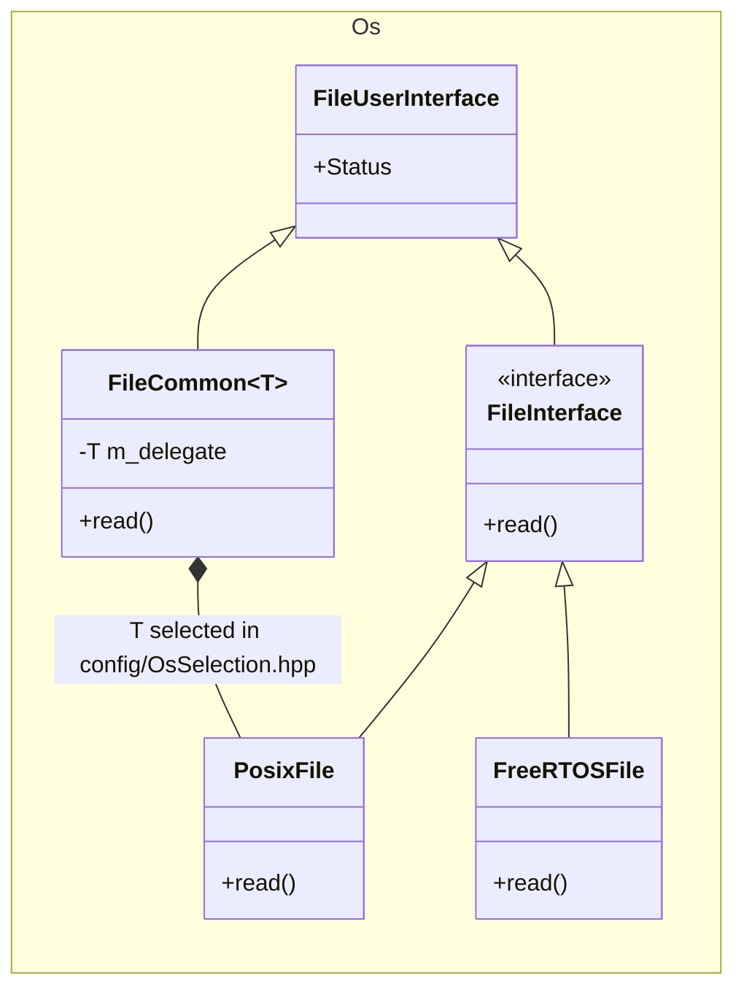

# Operating System Abstraction Layer (OSAL)

## 1. Introduction

### 1.1 Purpose
The Operating System Abstraction Layer (OSAL) provides a portable interface to operating system services for the framework. It abstracts platform-specific OS functionality behind a common API, enabling F´ applications to run on multiple operating systems without modification to the source code.

### 1.2 Scope
This document describes the high-level architecture and design of the OSAL, including its abstraction patterns, supported features, and implementation strategy. It does not provide detailed API specifications or implementation details.

## 2. Core Services

Core services are those that directly wrap OS primitives and are implemented by each platform backend.  They form the foundation upon which derived and generic services are built.

### 2.1 Concurrency

| Service | Purpose |
|---|---|
| **Mutex** | Mutual-exclusion lock and RAII `ScopeLock` helper. |
| **CountingSemaphore** | Counting semaphore for resource counting and thread synchronization. |
| **Task** | Thread creation, joining, and lifecycle management including start/stop callbacks. Priority is platform-defined; `TASK_PRIORITY_DEFAULT` selects the platform default. The Posix backend additionally accepts `Os::Posix::Task::PosixTask::TASK_PRIORITY_NON_REALTIME` (FPP: `Os.Posix.TASK_PRIORITY_NON_REALTIME`) to run a task under the non-realtime `SCHED_OTHER` policy rather than `SCHED_RR`; see [Non-Realtime Tasks on POSIX](../../docs/user-manual/framework/run-multi-core.md#non-realtime-tasks-on-posix). |
| **Queue** | Inter-task message passing with configurable depth, priority support, and blocking modes. |

### 2.2 File system

| Service | Purpose |
|---|---|
| **File** | Open, read, write, seek, flush, and CRC computation on files. |
| **Directory** | Open, iterate, and create directory entries. |
| **FileSystem** | Higher-level operations: remove, move/rename, copy, stat, query free space, and working-directory management. |

### 2.3 System Resources

| Service | Purpose |
|---|---|
| **RawTime** | Access to the system clock for measuring time intervals. |
| **Cpu** | CPU count and per-CPU usage statistics. |
| **Memory** | System memory usage statistics. |

### 2.4 Console

| Service | Purpose |
|---|---|
| **Console** | Write messages to the system console. |

## 3. Derived Services

Derived services are built on top of core services, providing higher-level abstractions that are implemented through the usage of core services.

| Service | Purpose | Core Services Used |
|---|---|---|
| **ConditionVariable** | Condition-variable signaling, paired with Mutex for producer/consumer patterns. | Mutex |
 |**ScopeLock** | RAII helper for automatically acquiring and releasing a Mutex within a specific scope. | Mutex |
| **IntervalTimer** | Lightweight start/stop timer for measuring elapsed microseconds. | RawTime |

## 4. Generic Services

Generic services are implemented in the `Os::Generic` namespace and are not tied to platform-specific functionalities. They provide utilities or abstractions that are not tied to any specific OS, but are related to OS-level operations and are therefore included in the `Os` module.

| Service | Purpose |
|---|---|
| **PriorityQueue** | Heap-based priority queue implementation |
| **LocklessPriorityQueue** | Lockless ISR-safe priority queue implementation |
| **FilePathUtils** | Textual path resolution (collapsing `.`/`..`/`//`) and directory-containment checking. No filesystem access; suitable for embedded targets. |
| **SandboxedFile** | Composition wrapper around `Os::File` that validates all paths on `open()` against a configured allowed directory, preventing path-traversal attacks. |

## 5. Implementation Architecture

### 5.1 Wrapper Pattern

Every OSAL _core service_ (e.g. File, Task, Mutex, etc.) follows a uniform three-layer pattern:

| Layer | Example | Description |
|---|---|---|
| User interface | [`Os::FileUserInterface`](../File.hpp) | A struct holding the types, enumerations and constants shared by the wrapper and the implementations (e.g. `Status`). |
| Interface | [`Os::FileInterface`](../Interfaces/FileInterface.hpp) | A pure-virtual base class, derived from the user interface, that defines the contract an implementation must meet. |
| Wrapper | [`Os::FileCommon<T>`](../File.hpp) | A class template, derived from the user interface, that holds the implementation `T` by value and forwards to it. `Os::File` is an alias of the wrapper instantiated on the selected implementation. Application code interacts exclusively with `Os::File`. |
| Implementation | [`Os::Posix::File::PosixFile`](../Posix/File.hpp) | A concrete class that implements the interface. This is what needs to be implemented to support a new OS on F Prime. |

This structure applies to every OSAL service: Console, ConditionVariable, CountingSemaphore, Cpu, Directory, File, FileSystem, Memory, Mutex, Queue, RawTime and Task. The wrapper adds the behavior common to all implementations (argument and state assertions, state tracking, convenience functions such as `Os::Mutex::lock()`), so implementations supply only the OS-specific operations.

The following diagram (simplified for brevity) illustrates the relationship between these layers for the File service. The same pattern applies to all other services. In `Os::File`, the OS functions (e.g. `open()`, `read()`, `close()`) are forwarded to `m_delegate`, a member of the selected implementation type.

### 5.2 Compile-Time Selection

The implementation used by each service is selected at compile time:

1. The configuration header `config/OsSelection.hpp` defines each `Os::<Service>` as an alias of `Os::<Service>Common<T>` for the selected implementation `T`, and defines an `OS_<SERVICE>_HEADER` macro naming the header that defines `T`.
2. The wrapper holds `T` by value; there is no factory function and no handle storage.
3. Calls from the wrapper to the implementation are direct calls on a known type, which the compiler can devirtualize and inline.

F´ provides a default `default/config/OsSelection.hpp` selecting the in-tree implementations. Projects and platforms override that header to select others; an override replaces the whole file and must define every alias and macro.

**Constraints:**

- **One selection per build**: `Os::<Service>` is a different type for each selection, so every file in a build must see the same `config/OsSelection.hpp`.
- **No circular dependencies**: the configuration header must not include Os OSAL headers; it forward-declares the implementations.
- **Linking**: the alias changes only the C++ type. The module providing the implementation must still be in the link.
- **Mutex and ConditionVariable** must be selected as a compatible pair: a condition variable implementation operates on the handle of the selected `Os::Mutex` (Posix casts it to its own handle type). `Os::ConditionVariableCommon` additionally requires that the same mutex is supplied on every call to `pend()`/`wait()`, returning `ERROR_DIFFERENT_MUTEX` otherwise.
- **RawTime** implementations must be copyable and constructible from a `RawTimeSource`.
- **Registries**: `Os::QueueRegistry` and `Os::TaskRegistry` track only wrappers of the selected implementation type.

**Testing:**

- A test of a specific implementation names its wrapper explicitly, e.g. `Os::MutexCommon<Os::Stub::Mutex::Test::TestMutex>`, independent of the selection.
- In unit test builds (`BUILD_UT`) the default selection wraps File and RawTime in `Os::Ut::File::UtFile` and `Os::Ut::RawTime::UtRawTime`. These hold the implementation a non-test build would select and route each call through a test-only interceptor ([`Os/Interfaces/Test/`](../Interfaces/Test)) when a test installs one.

## 6. OSAL Implementations

The following OSAL implementations are available in the core F´ repository:

| Backend | Location | Description |
|---|---|---|
| **Posix** | `Os/Posix/` | Full implementation using POSIX APIs (`pthread`, file I/O, `clock_gettime`, etc.).  Serves as the default for Linux, macOS, and other POSIX compliant systems. |
| **Stub** | `Os/Stub/` | No-op implementations that return `Status::NOT_SUPPORTED`. Useful while some implementations are not available to a platform. |

Additional OSAL implementations are available through platform support packages. For more information, see [Supported Platforms](../../docs/user-manual/framework/supported-platforms.md) or search for a platform support package in the [fprime-community](https://github.com/fprime-community) GitHub organization.

OSAL selection is made in `config/OsSelection.hpp` (see [Compile-Time Selection](#52-compile-time-selection)); the CMake build system brings the module of each selected implementation into the link.

## 7. Resources

- [How-To: Implement an OSAL](../../docs/how-to/integrate/implement-osal.md) — Step-by-step guide to implementing a new OSAL backend.
- [Posix OSAL implementation](https://github.com/nasa/fprime/tree/devel/Os/Posix) — Reference implementation for POSIX systems.
- [fprime-zephyr](https://github.com/fprime-community/fprime-zephyr) — OSAL implementation for Zephyr RTOS.
- [fprime-vxworks](https://github.com/fprime-community/fprime-vxworks) - OSAL implementation for VxWorks RTOS.
- [fprime-freertos](https://github.com/fprime-community/fprime-freertos/tree/main/FreeRTOS/Os) - OSAL implementation for FreeRTOS.
