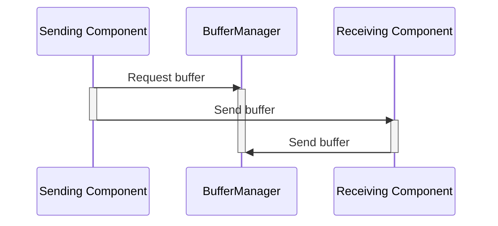

# Svc::BufferManager

## 1 Introduction

`BufferManager` is a passive F Prime component.
It allocates a set of fixed-sized buffers as specified by the user. The overall memory for the buffers is allocated by a memory allocator provided to the component at runtime.

**For a detailed guide on how to use the BufferManager component, please refer to the [Buffer Pool Guide](../../../docs/user-manual/framework/memory-management/buffer-pool.md).**

## 2 Requirements

Requirement | Description | Rationale | Verification Method
---- | ---- | ---- | ----
FPRIME-BM-001 | `BufferManager` shall allow the specification of multiple bins of buffers based on the size of the buffer|Allows for some optimization of memory usage if buffers of varying sizes are needed|Test|
FPRIME-BM-002 | `BufferManager` shall allocate the first buffer with capacity at least the requested size from the set of unallocated buffers, starting with the smallest set of buffers.|If a buffer from a smaller pool is not available, allow using larger buffers to avoid starving the user| Test|
FPRIME-BM-003 | `BufferManager` shall return an empty buffer (size = 0) if no buffers are available|Allow the user to decide how to react to no memory|Test|
FPRIME-BM-004 | `BufferManager` shall accept empty returned buffers without an assert|Just send a warning to cover the case where an empty buffer is returned by a component|Test
FPRIME-BM-005 | `BufferManager` shall use a provided Fw::MemAllocator instance to request overall buffer memory|Let the user decide where the memory comes from|Test
FPRIME-BM-006 | `BufferManager` shall allow buffers to be returned in any order|Do not restrict the lifetime or usage of buffers|Test
FPRIME-BM-007 | `BufferManager` shall return a buffer whose size is set exactly to the requested size|Allow callers to use the requested size without checking the underlying allocation size|Test|
FPRIME-BM-008 | `BufferManager` shall assert during setup if the bins with a non-zero `numBuffers` are not ordered by non-decreasing buffer size|The allocation search is a linear first fit over the bins in configuration order, so FPRIME-BM-002 holds only when smaller bins precede larger ones|Test|
FPRIME-BM-009 | `BufferManager` shall return an empty buffer and issue a warning event for a request of size zero, without allocating a buffer|A zero-sized buffer is indistinguishable from the "no buffers available" result to the caller, so serving it would silently consume a buffer|Test|
FPRIME-BM-010 | `BufferManager` shall assert during setup if the bins contain no buffers, or if a non-empty bin has a buffer size of zero|A pool with no buffers is a configuration error (and allocating zero bytes has allocator-dependent results); a bin of zero-sized buffers can never serve a request|Test|
FPRIME-BM-011 | `BufferManager` shall assert if `setup()` is called while already set up|Setting up over a live pool would leak it|Test|
FPRIME-BM-012 | `BufferManager` shall support `setup()` after `cleanup()`: the new pool shall be released by the next `cleanup()` and the current and high-water buffer counts shall restart at zero|Re-initialization must not leak the new pool or attribute the old pool's usage to it|Test|

## 3 Design

### 3.1 Assumptions

The design of `BufferManager` assumes the following:

1. `BufferManager` has some maximum number of outstanding allocations, 
set at component initialization, that is never exceeded.

2. The store maintained by `BufferManager` has a fixed size, 
set at component initialization.
This fixed size is never exceeded by the outstanding allocations.

### 3.2 Block Description Diagram (BDD)


### 3.3 Ports

#### 3.3.1 Role Ports

Name | Type | Role
-----| ---- | ----
`timeCaller` | `Fw::Time` | TimeGet
`tlmOut` | [`Fw::Tlm`](../../../Fw/Tlm/docs/sdd.md) | Telemetry
`eventOut` | [`Fw::LogEvent`](../../../Fw/Log/docs/sdd.md) | LogEvent

#### 3.3.2 Component-Specific Ports

Name | Type | Kind | Purpose
---- | ---- | ---- | ----
`bufferSendIn` | [`Fw::BufferSend`](../../../Fw/Buffer/docs/sdd.md) | guarded input | Receives buffers for deallocation
`bufferGetCallee` | [`Fw::BufferGet`](../../../Fw/Buffer/docs/sdd.md) | guarded input (callee) | Receives requests for allocated buffers and returns the buffers
`schedIn` | [`Svc::Sched`](../../../Svc/Sched/docs/sdd.md) | guarded input (callee) | writes telemetry values (optional, if the user doesn't need BufferManager telemetry)

### 3.4 Constants

`BufferManager` maintains the following constants:

* *BUFFERMGR_MAX_NUM_BINS*: The maximum number of bins (i.e. buffers pool of different sizes)

### 3.5 State

`BufferManager` maintains the following state:

* *m_memory*: The single allocation obtained in `setup()`: the buffer payloads followed by the tracking structures; released by `cleanup()`.
* *m_buffers*: The tracking structures, one per buffer in the pool, inside *m_memory* after the payloads.
* *m_currBuffs*, *m_highWater*: The number of buffers currently allocated and the most ever allocated from the current pool (`CurrBuffs`, `HiBuffs`).
* *m_noBuffs*, *m_emptyBuffs*: The number of requests that could not return a buffer (including zero-size requests) and the number of empty buffers returned (`NoBuffs`, `EmptyBuffs`).

`cleanup()` releases the pool whether or not every buffer has been returned; buffers still out become invalid with it. On `setup()` after `cleanup()`, *m_currBuffs* and *m_highWater* restart at zero with the new pool; *m_noBuffs* and *m_emptyBuffs* persist over the lifetime of the instance.

* *AllocatedBuffer::allocated*: Indicates whether a particular buffer in the pool has been allocated to the user.

### 3.6 Port Behavior

#### 3.6.1 bufferGetCallee

When `BufferManager` receives a request for a buffer of size *s* on
[*bufferGetCallee*](#bufferGetCallee), it carries out the following steps:

1. If the requested size is zero, issue the `ZeroSizeRequest` WARNING_HI event (throttled), count it in `NoBuffs`, and return an empty buffer without allocating.
2. Search for an unallocated buffer that is big enough to hold the requested buffer size.
3. Mark the buffer as allocated.
4. Set the returned buffer's size to the requested size. The underlying allocation may be larger.
5. Return the `Fw::Buffer` instance to the user.
6. If a free buffer cannot be found, issue the `NoBuffsAvailable` WARNING_HI event (throttled), count it in `NoBuffs`, and return an empty buffer to the user.

#### 3.6.2 bufferSendIn

When `BufferManager` receives notification of a free buffer on
[*bufferSendIn*](#bufferSendIn), it carries out the following steps:

1. Check to see if it is an empty buffer. If so, issue the `NullEmptyBuffer` WARNING_HI event (throttled), count it in `EmptyBuffs`, and return.
2. Extract the manager ID and buffer ID from the context member of the `Fw::Buffer` instance.
3. If they are valid, use the buffer ID to find the allocated buffer.
4. Clear the "allocated" flag to make the buffer available again.

#### 3.6.3 schedIn

The `schedIn` port is optional. It doesn't need to be connected for `BufferManager` to function correctly. When `BufferManager` receives a call on this port, it will write all the defined telemetry values.

### 3.7 Sequence Diagram

The following sequence diagram shows the procedure for sending a buffer
from one component to another:

1. The sending component requests a buffer *B* on the
[`bufferGetCallee`](#bufferGetCallee) port of `BufferManager`.

2. The sending component fills *B* with data and sends it to the receiving
component.

3. The receiving component uses the data in *B*. When done, it sends *B* back
to the [`bufferSendIn`](#bufferSendIn) port of `BufferManager` for deallocation.



### 3.8 Assertions

`BufferManager` will assert under the following conditions:

* A returned buffer has the incorrect manager ID.
* A returned buffer has an incorrect buffer ID.
* A returned buffer is returned with a correct buffer ID, but it isn't already allocated.
* A returned buffer has an indicated size larger than originally allocated.
* A returned buffer has a pointer different than the one originally allocated.
* The non-empty bins passed to `setup()` are not ordered by non-decreasing buffer size.
* The bins passed to `setup()` contain no buffers.
* `setup()` is called while the instance is already set up.
* A bin with a non-zero `numBuffers` has a `bufferSize` of zero.
* The alignment passed to `setup()` is zero or not a power of two.
* The allocator returns memory not aligned as requested (the requested alignment, or that of the buffer tracking structures if larger).

## 4 Configuration

### 4.1 Constants

The maximum number of buffer bins is configured in the config file [`config/BufferManagerComponentImplCfg.hpp`](../../../default/config/BufferManagerComponentImplCfg.hpp):

```cpp
namespace Svc {
    static const U16 BUFFERMGR_MAX_NUM_BINS = 10;
}
```

### 4.2 Runtime Setup

To configure an instance of `BufferManager`, the following needs to be supplied to its `setup()` method:

- `mgrID`: A unique manager ID for buffer checking
- `memID`: ID passed to the memory allocator
- `allocator`: An `Fw::MemAllocator` instance
- `bins`: A `BufferBins` structure defining the buffer pools (size and number). This is defined by the user, as demonstrated below.
- `alignment` (optional): The alignment requested from the allocator for the pool, a non-zero power of two. Defaults to `alignof(std::max_align_t)`, the same default as `Fw::MemAllocator::allocate()`.

The `setup` method configures the buffer bins, allocates memory for all buffers, and initializes the buffer tracking structures. The single allocation is requested at `alignment` (or the alignment of the tracking structures, if that is larger) and holds the buffer payloads first, packed in bin order, followed by the tracking structures: the first payload starts at the allocation's address, so it has the requested alignment, and each later payload is offset by the preceding buffer sizes only, so its alignment depends on the configured buffer sizes and never on the tracking structure size. `setup()` asserts if the allocator returns memory that does not honor the requested alignment; `Fw::MallocAllocator` ignores the alignment argument and provides `malloc`'s alignment only.

### 4.3 Buffer Bins Configuration

Buffer bins are defined using the `BufferBins` structure, which contains an array of `BufferBin` entries. Each bin entry specifies:

- `bufferSize`: The size of each buffer in the bin (in bytes)
- `numBuffers`: number of buffers of `bufferSize` to allocate for this bin

Bins with a non-zero `numBuffers` must be listed in non-decreasing `bufferSize` order (empty bins may appear anywhere); `setup()` asserts otherwise. Buffer requests are served by the first bin in this order that has a free buffer of sufficient size, so this ordering is what makes the smallest suitable buffer the one returned.

Choosing appropriate buffer sizes and counts depends on the expected usage patterns of the system. Users should analyze their application's memory requirements to determine optimal configurations.

**Example configuration:**

```cpp
Svc::BufferManager::BufferBins bins;
memset(&bins, 0, sizeof(bins));
bins.bins[0].bufferSize = 256;   // Small buffers
bins.bins[0].numBuffers = 10;    // 10 small buffers

bins.bins[1].bufferSize = 1024;  // Medium buffers
bins.bins[1].numBuffers = 5;     // 5 medium buffers

bins.bins[2].bufferSize = 4096;  // Large buffers
bins.bins[2].numBuffers = 2;     // 2 large buffers

bufferManager.setup(1, 0, allocator, bins);
```

A real-world usage and configuration example can be found in the [`Svc.ComCcsds` subtopology](../../Subtopologies/ComCcsds/).
