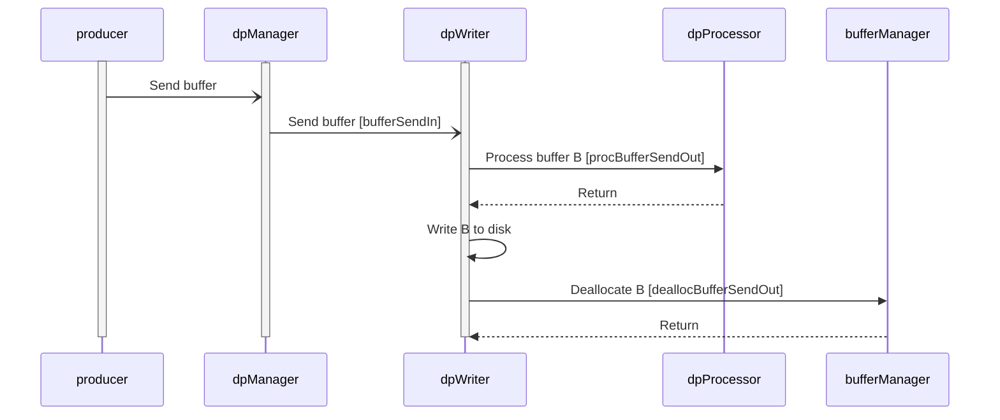

# Svc::DpWriter (Active Component)

## 1. Introduction

`Svc::DpWriter` is an active component for writing data products to disk.
It does the following:

1. Receive buffers containing filled data product containers.
The buffers typically come from one or more components that produce
data products.
They typically pass through an instance of
[`Svc::DpManager`](../../DpManager/docs/sdd.md), and possibly through
an instance of
[`Svc::BufferAccumulator`](../../BufferAccumulator/docs/sdd.md),
before reaching `DpWriter`.

1. For each buffer _B_ received in step 1:

   1. Perform any requested processing, such as data compression, on _B_.

   1. Write _B_ to disk.

   1. If a notification port is connected, then send out a notification
that the write occurred.
An instance of [`Svc::DpCatalog`](../../DpCatalog/docs/sdd.md) can
receive this notification and use it to update the data product catalog.

## 2. Requirements

Requirement | Description | Rationale | Verification Method
----------- | ----------- | ----------| -------------------
SVC-DPWRITER-001 | `Svc::DpWriter` shall provide an array of ports for receiving `Fw::Buffer` objects pointing to filled data product containers. | The purpose of `DpWriter` is to write the data products to disk. The array permits the fusion of multiple logical writer components with separate routing paths into a single component. This fusion increases resource efficiency (it requires fewer component instances and threads), but it restricts concurrency by forcing sequential execution of all routing paths on the same thread. The component allows developers to manage this tradeoff. | Unit Test
SVC-DPWRITER-002 | `Svc::DpWriter` shall provide an array of ports for sending `Fw::Buffer` objects for processing. | This requirement supports downstream processing of the data in the buffer. | Unit Test
SVC-DPWRITER-003 | On receiving a data product container _C_, `Svc::DpWriter` shall use the processing type field of the header of _C_ to select zero or more processing ports to invoke, in port order. | The processing type field is a bit mask. A one in bit `2^n` in the bit mask selects port index `n`. | Unit Test
SVC-DPWRITER-004 | On receiving an `Fw::Buffer` _B_, and after performing any requested processing on _B_, `Svc::DpWriter` shall write _B_ to disk. | The purpose of `DpWriter` is to write data products to the disk. | Unit Test
SVC-DPWRITER-005 | `Svc::DpWriter` shall provide an array of ports for notifying other components that data products have been written. A notification shall use the same routing port index as the corresponding input buffer. | The notification output allows `Svc::DpCatalog` or a similar component to update a data product catalog in real time. It is possible to notify a single instance of `Svc::DpCatalog` of all outputs, by connecting all the output ports of `Svc::DpWriter` to that component. It is also possible to notify different components via the different output ports. The array preserves symmetry across the port behaviors of this component (input, buffer return, and notification). | Unit Test
SVC-DPWRITER-006 | `Svc::DpWriter` shall provide telemetry that reports the number of buffers received, the number of data products written, the number of bytes written, the number of failed writes, and the number of errors. | This requirement establishes the telemetry interface for the component. | Unit test
SVC-DPWRITER-007 | On receiving an `Fw::Buffer` _B_, and after performing any requested processing on _B_, `Svc::DpWriter` shall re-parse the container header and shrink the size of the product. | Allows processing interfaces to compress data products and communicate that compressed state back to `Svc::DpWriter`. | Unit Test
SVC-DPWRITER-008 | `Svc::DpWriter` shall return each valid received buffer on the `deallocBufferSendOut` port whose index matches the `bufferSendIn` port that received it. | Matching send and return paths allows a `DpWriter` instance to route buffers back toward the correct allocator. | Unit Test
SVC-DPWRITER-009 | `Svc::DpWriter` shall provide a command that sets a processing override consisting of a state (`ENABLED` or `DISABLED`) and a bit mask of processing types. When the state is `ENABLED`, the processing types in the mask shall be performed on every received container in addition to those requested in its header. When the state is `DISABLED`, the processing types in the mask shall not be performed on any received container, even if requested in its header. | Processing such as compression is safe to apply to any data product, and operators need to turn it on or off for a whole deployment without every producing component supporting a per-container setting. An empty mask disables the override, restoring header-controlled processing. | Unit Test, Integration Test
SVC-DPWRITER-010 | `Svc::DpWriter` shall reject, with a validation error and a warning event, a processing override whose mask selects a processing port that does not exist or, when the state is `ENABLED`, a processing port that is not connected. | A ground command must not be able to drive an unconnected port, which would assert the flight software. | Unit Test
SVC-DPWRITER-011 | `Svc::DpWriter` shall record the processing types actually performed in the header of each written data product and shall report the current processing override state and mask in telemetry. | The data product file records the processing applied to it, and operators can confirm the override in effect. | Unit Test

## 3. Design

### 3.1. Component Diagram

The diagram below shows the `DpWriter` component.

### 3.2. Ports

`DpWriter` has the following ports:

| Kind | Name | Port Type | Usage |
|------|------|-----------|-------|
| `sync input` | `schedIn` | `Svc.Sched` | Schedule in port |
| `internal` (`hook`) | `schedInInternal` | n/a | Performs the `schedIn` work on the component thread; at most one message queued |
| `async input` | `bufferSendIn` | `[DpWriterNumPorts] Fw.BufferSend` | Ports for receiving data products to write to disk |
| `output` | `procBufferSendOut` | `[DpWriterNumProcPorts] Fw.BufferSend` | Port for processing data products |
| `output` | `dpWrittenOut` | `[DpWriterNumPorts] DpWritten` | Ports for sending `DpWritten` notifications |
| `output` | `deallocBufferSendOut` | `[DpWriterNumPorts] Fw.BufferSend` | Ports for returning data product buffers |
| `time get` | `timeGetOut` | `Fw.Time` | Time get port |
| `telemetry` | `tlmOut` | `Fw.Tlm` | Telemetry port |
| `event` | `eventOut` | `Fw.Log` | Event port |
| `text event` | `textEventOut` | `Fw.LogText` | Text event port |

The `bufferSendIn`, `dpWrittenOut`, and `deallocBufferSendOut` arrays form matching routing paths. A buffer received at index _N_ is notified and returned through index _N_. Topologies must connect `deallocBufferSendOut[N]` for every connected `bufferSendIn[N]`; the buffer return is unconditional and invoking an unconnected return port asserts. `dpWrittenOut[N]` may be left unconnected.

### 3.3. State

`DpWriter` maintains the following state:

| Member | Type | Description |
| --- | --- | --- |
| `m_numBuffersReceived` | `U32` | The number of buffers received |
| `m_numBytesWritten` | `U64` | The number of bytes written |
| `m_numSuccessfulWrites` | `U32` | The number of successful writes |
| `m_numFailedWrites` | `U32` | The number of failed writes |
| `m_numErrors` | `U32` | The number of errors |
| `m_procOverrideState` | `Fw::Enabled` | `ENABLED` forces the override processing types on; `DISABLED` forces them off. Initially `DISABLED`. |
| `m_procOverrideMask` | `Fw::DpCfg::ProcType::SerialType` | The processing types forced by the override. Initially zero, meaning no override. |

The component also retains its configured file-name prefix in `m_dpFileNamePrefix`.

The override state is read and written only on the component thread (the
command and `bufferSendIn` are both asynchronous), so no lock is needed.

### 3.4. Compile-Time Setup

1. The configuration constant [`DpWriterNumPorts`](../../../default/config/AcConstants.fpp)
   specifies the number of matched input, notification, and buffer-return routing paths.
   Its default value is five, matching the default `DpManagerNumPorts` configuration.
   Projects can override this value to fit their topology. All routing paths share one
   message queue with `schedIn` and the asynchronous `CLEAR_EVENT_THROTTLE` command.
   Size the queue for the sum of the maximum queued buffers across all connected paths,
   plus the maximum pending scheduler ticks and commands. If at most one tick and one
   command can be pending, reserve at least two additional slots; deployments permitting
   larger bursts must reserve more. A full queue asserts.

1. The configuration constant [`DpWriterNumProcPorts`](../../../default/config/AcConstants.fpp)
   specifies the number of ports for connecting components that perform
   processing.

1. The configuration [`DP_FILENAME_FORMAT`](../../../default/config/DpCfg.hpp)
   specifies the file name format.

### 3.5. Runtime Setup

You can call the `configure` function to supply the DP file name
prefix. This is the prefix used when constructing names of files to write.
For more information about the file name format, see the [**File
Format**](#file_format) section.

If you do not call the `configure` function, then the default
DP file name prefix is the empty string.

### 3.6. Port Handlers

#### 3.6.1. schedIn

This handler sends out the state variables as telemetry.

#### 3.6.2. bufferSendIn

This handler receives a mutable reference to a buffer `B` on routing port _N_.
It does the following:

1. Check that `B` is valid. If not, emit a warning event.

1. If the previous step succeeded, then check that the size of `B` is large enough to
   hold a data product container packet. If not, emit a warning event.

1. If the previous steps succeeded, then check that the packet
   header of `B` can be successfully deserialized.
   If not, emit a warning event.

1. If the previous steps succeeded, then check that the header
   hash of `B` is valid.
   If not, emit a warning event.

1. If the previous steps succeeded, then check that the data
   size recorded in the packet header fits within the buffer.
   If not, emit a warning event.

1. If the previous steps succeeded, then

   1. Read the `ProcType` field out of the container header stored in the
      memory pointed to by `B`. Let the resulting bit mask be `R`.

   1. Apply the processing override to `R` to obtain the effective bit
      mask `M`: if `m_procOverrideState` is `ENABLED`, `M` is `R` with the
      bits of `m_procOverrideMask` set; otherwise `M` is `R` with the bits
      of `m_procOverrideMask` cleared.

   1. Visit the port numbers of `procBufferSendOut` in order.
      For each port number `P`, if `P` is set in `M`, then invoke
      `procBufferSendOut` at port number `P`, passing in `B`.
      This step updates the memory pointed to by `B` in place.

   1. If any port was invoked, re-parse the container header pointed to
      by `B`.

   1. If any port was invoked or `M` differs from `R`, record `M` in the
      `ProcType` field of the container header, recompute the header hash,
      serialize the header into `B`, and if necessary shrink the size of
      the `B` buffer to be consistent with the data size in the updated
      container header.

   1. Write `B` to a file, using the format described in the [**File
      Format**](#file_format) section. For the time stamp, use the time
      provided by `timeGetOut`.

1. If the file write succeeded and `dpWrittenOut[N]` is connected, then send the
   file name, priority, and file size out on `dpWrittenOut[N]`.

1. If `B` is valid, then send `B` on `deallocBufferSendOut[N]`.

### 3.7. Command Handlers

#### 3.7.1. CLEAR_EVENT_THROTTLE

This handler clears the throttling of all throttled events and returns a
command response of `OK`.

#### 3.7.2. SET_PROC_OVERRIDE

This handler receives a state `S` (`ENABLED` or `DISABLED`) and a
processing type bit mask `M`. It does the following:

1. Compute the allowed bit mask `A`. For each port number `P` of
   `procBufferSendOut`, bit `P` is set in `A` if `S` is `DISABLED`, or if
   `S` is `ENABLED` and `procBufferSendOut[P]` is connected.
   Bits at or above the number of processing ports are never set in `A`.

1. If `M` has any bit set that is not set in `A`, emit the
   `ProcOverrideInvalid` warning event and return a command response of
   `VALIDATION_ERROR`, leaving the override unchanged.

1. Otherwise store `S` in `m_procOverrideState` and `M` in
   `m_procOverrideMask`, emit the `ProcOverrideSet` event, and return a
   command response of `OK`. The new override applies to every container
   received afterwards.

Setting `M` to zero in either state removes the override.

## 4. File Format

### 4.1. Data Format

Each file stores a serialized data product record,
with the format described in the
[data products documentation](../../../Fw/Dp/docs/sdd.md#serial-format).

### 4.2. File Name

The name of each file is formatted with the configurable format string
[`DP_FILENAME_FORMAT`](../../../default/config/DpCfg.hpp).
The format string must contain format specifications for the following arguments,
in order.

Format Specifier | Type |
---------------- | -----|
The DP file name prefix | `%s`
Container ID | `%PRI_FwDpIdType`
Time seconds | `%PRI_u32`
Time microseconds | `%PRI_u32`

The exact meaning of the DP file name prefix depends on the format string.
Typically it is a directory path prefix.

## 5. Ground Interface

### 5.1. Commands

| Kind | Name | Description |
|------|------|-------------|
| `async` | `CLEAR_EVENT_THROTTLE` | Clear event throttling |
| `async` | `SET_PROC_OVERRIDE` | Set the processing override applied to every data product container: `state` (`Fw.Enabled`) selects whether the `procTypes` bit mask (`U8`, bits of `Fw.DpCfg.ProcType`) is forced on or forced off; a zero mask removes the override |

### 5.2. Telemetry

| Name | Type | Description |
|------|------|-------------|
| `NumBuffersReceived` | `U32` | The number of buffers received |
| `NumBytesWritten` | `U64` | The number of bytes written |
| `NumSuccessfulWrites` | `U32` | The number of successful writes |
| `NumFailedWrites` | `U32` | The number of failed writes |
| `NumErrors` | `U32` | The number of errors |
| `ProcOverrideState` | `Fw.Enabled` | The processing override state: `ENABLED` forces processing types on; `DISABLED` forces them off |
| `ProcOverrideMask` | `U8` | The bit mask of processing types forced by the processing override; zero means no override |

### 5.3. Events

| Name | Severity | Description |
|------|----------|-------------|
| `InvalidBuffer` | `warning high` | Incoming buffer is invalid |
| `BufferTooSmallForPacket` | `warning high` | Incoming buffer is too small to hold a data product packet |
| `InvalidHeaderHash` | `warning high` | Incoming buffer has an invalid header hash |
| `InvalidHeader` | `warning high` | An error occurred while deserializing the packet header |
| `BufferTooSmallForData` | `warning high` | Buffer is too small for the data size specified in the header |
| `FileNameFormatError` | `warning high` | An error occurred when formatting a file name |
| `FileOpenError` | `warning high` | An error occurred when opening a file |
| `FileWriteError` | `warning high` | An error occurred when writing to a file |
| `FileWritten` | `activity low` | A data product file was written |
| `ProcOverrideSet` | `activity high` | The processing override was set |
| `ProcOverrideInvalid` | `warning low` | The processing override was rejected because it selected a nonexistent or unconnected processing port |

## 6. Example Uses

### 6.1. Topology Diagrams

The following topology diagram shows how to connect `Svc::DpWriter`
to a `DpManager` component and a processor component.
The diagrams use the following instances:

* `dpManager`: An instance of [`Svc::DpManager`](../../DpManager/docs/sdd.md).

* `dpProcessor`: A component that processes data product containers.

* `dpWriter`: An instance of `Svc::DpWriter`.

* `producer`: A component that produces data products.

### 6.2. Sequence Diagrams

The following diagram shows what happens when a buffer is sent to `DpWriter`,
is processed, and is written to disk.

