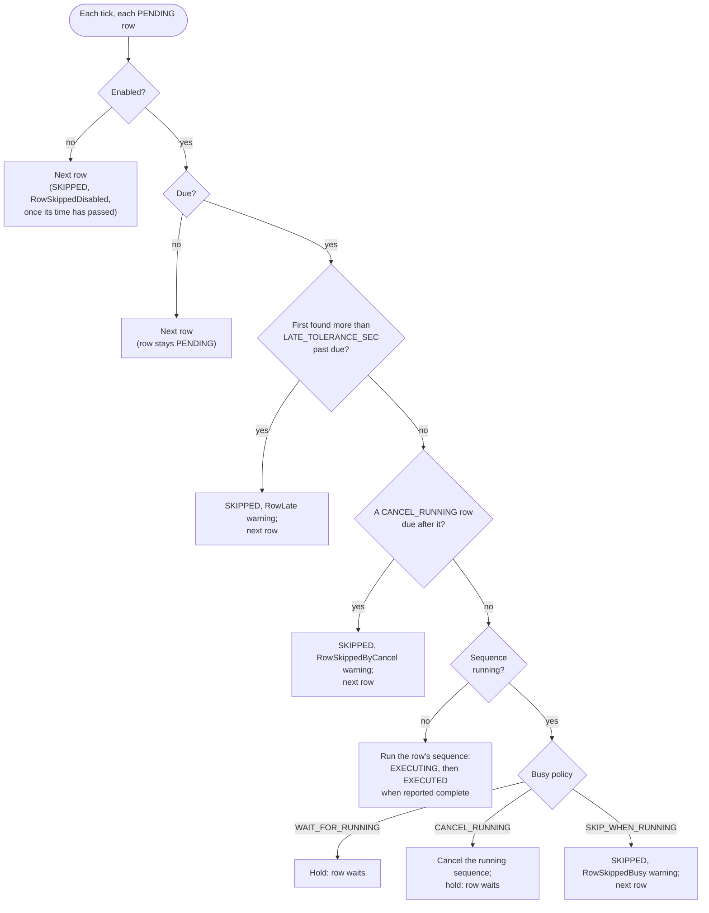
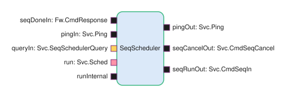
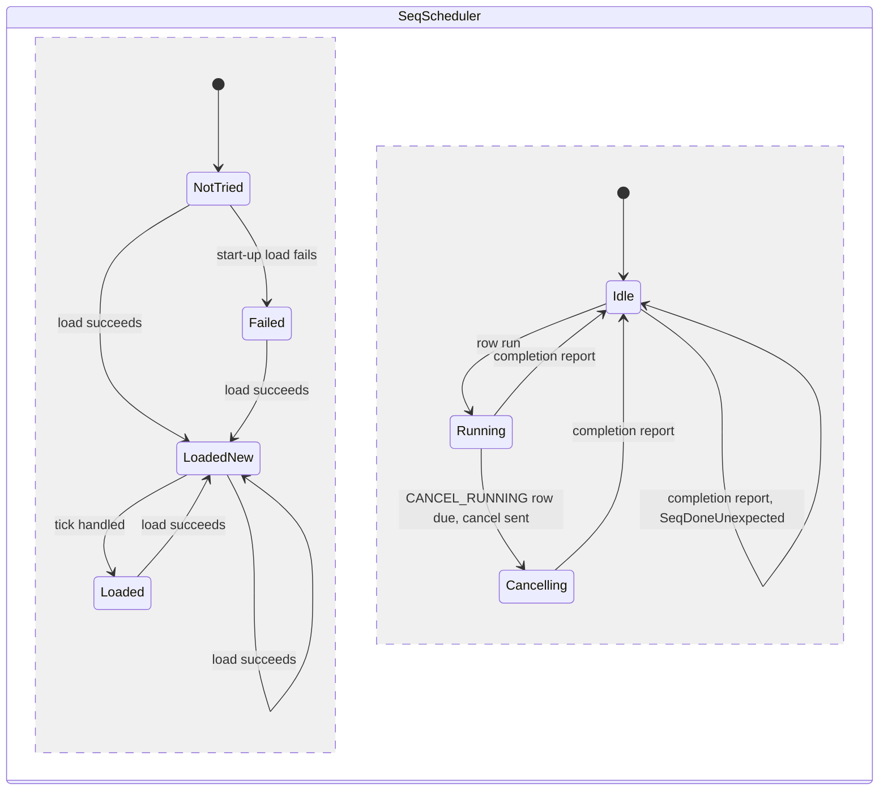
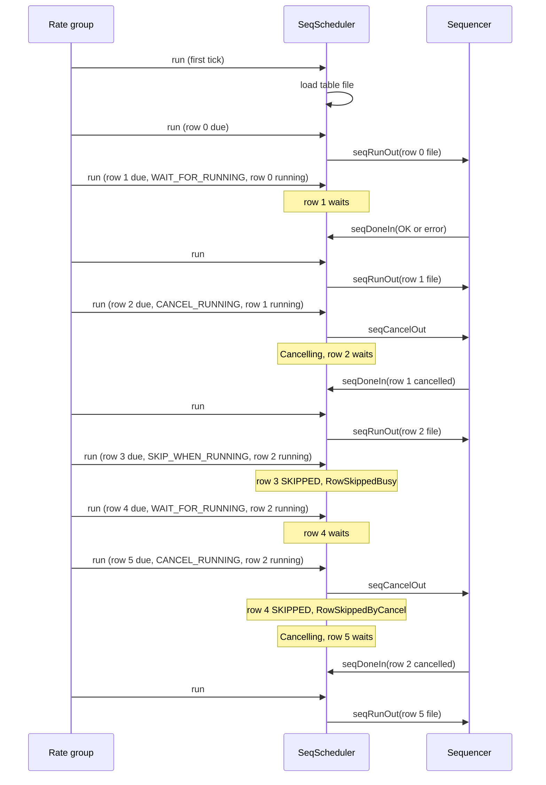

# Svc::SeqScheduler (Active Component)

## 1. Introduction

`Svc::SeqScheduler` runs command sequences at scheduled times from a table of rows whose length is set when the component is configured.
Each row names a sequence file and a time that is absolute, relative to software start, or
relative to the first schedule tick on which a time base is reported. The table is loaded from a
file and can be edited by command; each due row's sequence is run on the attached sequencer.
Another component can query the upcoming rows and their times. Several instances may run in one
deployment.

## 2. Requirements

| ID | Requirement | Verification |
|---|---|---|
| REQ-SeqScheduler-001 | The component shall load the table file before evaluating any row or handling any command. The file is named by parameter `TABLE_FILE` when that is set and not empty, and otherwise by the default name given to `configure`. | Unit Test |
| REQ-SeqScheduler-002 | Each table row shall store the fields listed in Section 4.1. | Unit Test |
| REQ-SeqScheduler-003 | A load failure shall emit `WARNING_HI`. After a failed start-up load the table shall be empty; after a failed load command the table shall be unchanged. A row set by command on an empty table shall be `PENDING` and shall run when due. | Unit Test |
| REQ-SeqScheduler-004 | The table shall hold the number of rows given to `configure`, in memory obtained once from the memory allocator given to `configure`; the number of rows shall not change afterwards. | Unit Test |
| REQ-SeqScheduler-005 | On a load command the component shall replace the table in memory with the content of the table file. | Unit Test |
| REQ-SeqScheduler-006 | An `ABSOLUTE` row shall become due when system time in its time base reaches row time. | Unit Test |
| REQ-SeqScheduler-007 | An `ABSOLUTE` row shall stay `PENDING` while system time is in a different time base. | Unit Test |
| REQ-SeqScheduler-008 | A `START_RELATIVE` row shall become due its time after the first schedule tick. | Unit Test |
| REQ-SeqScheduler-009 | A `TIME_BASE_RELATIVE` row shall become due its time after the first tick reporting its base. | Unit Test |
| REQ-SeqScheduler-010 | The delay of a `START_RELATIVE` or `TIME_BASE_RELATIVE` row shall be counted in schedule ticks: the row's time divided by the tick period given to `configure`, rounded up to a whole tick. A change of system time shall not change the delay. | Unit Test |
| REQ-SeqScheduler-011 | A `TIME_BASE_RELATIVE` row's start tick shall not move when its base is reported again after an absence. | Unit Test |
| REQ-SeqScheduler-012 | When an enabled row becomes due and no sequence run by this component is running, the component shall run the row's sequence file by a call on its sequence run port, unless REQ-SeqScheduler-060 skips the row. | Unit Test |
| REQ-SeqScheduler-013 | A row that becomes due while a sequence run by this component is running shall follow its busy policy: `WAIT_FOR_RUNNING`, `CANCEL_RUNNING` or `SKIP_WHEN_RUNNING`. | Unit Test |
| REQ-SeqScheduler-014 | A `WAIT_FOR_RUNNING` row shall run once the running sequence is reported complete, successfully or not, unless REQ-SeqScheduler-060 skips it first. | Unit Test |
| REQ-SeqScheduler-015 | A `CANCEL_RUNNING` row shall cancel the running sequence and run once the cancelled sequence is reported complete, unless REQ-SeqScheduler-060 skips it first. | Unit Test |
| REQ-SeqScheduler-016 | A `SKIP_WHEN_RUNNING` row shall become `SKIPPED` with `WARNING_LO`, its sequence not run. | Unit Test |
| REQ-SeqScheduler-017 | Due rows, rows waiting for the running sequence included, shall be handled in the order in which they came due, then row index. | Unit Test |
| REQ-SeqScheduler-018 | A completion report received while no sequence run by this component is running shall raise `WARNING_LO` and change nothing. | Unit Test |
| REQ-SeqScheduler-019 | The table data product shall report each row as `PENDING`, `EXECUTING`, `EXECUTED` or `SKIPPED`. | Unit Test |
| REQ-SeqScheduler-020 | A row shall become `EXECUTING` when its sequence is run and `EXECUTED` when that sequence is reported complete. | Unit Test |
| REQ-SeqScheduler-021 | An enabled `PENDING` row first found over `LATE_TOLERANCE_SEC` past due, and not waiting under its busy policy, shall become `SKIPPED` with `WARNING_LO`, its sequence not run, except as REQ-SeqScheduler-056 states. | Unit Test |
| REQ-SeqScheduler-022 | A disabled `PENDING` row reaching its due time shall become `SKIPPED` with `ACTIVITY_LO`, except as REQ-SeqScheduler-056 states. | Unit Test |
| REQ-SeqScheduler-023 | Every loaded row shall start `PENDING`. Row state shall not be held in the table file. | Unit Test |
| REQ-SeqScheduler-025 | The component shall enable or disable a row by index on command. | Unit Test |
| REQ-SeqScheduler-026 | The component shall enable or disable every row matching a sequence file name on command. | Unit Test |
| REQ-SeqScheduler-027 | The component shall set a row's time, time mode, sequence file name and busy policy together, by index, on one command. | Unit Test |
| REQ-SeqScheduler-028 | Setting a row shall return it to `PENDING`. | Unit Test |
| REQ-SeqScheduler-029 | Enabling or disabling a row shall not change its state. | Unit Test |
| REQ-SeqScheduler-030 | No table edit or load shall affect a sequence already running. | Unit Test |
| REQ-SeqScheduler-031 | Table edits shall not change the table file until a save command is received. | Unit Test |
| REQ-SeqScheduler-032 | A save command shall write the current table, without row states, to the table file. | Unit Test |
| REQ-SeqScheduler-033 | The component shall fail the save command and emit `WARNING_HI` on a file error. | Unit Test |
| REQ-SeqScheduler-034 | A command with an argument error listed in Section 5.1 shall fail with `WARNING_HI`, the table unchanged. | Unit Test |
| REQ-SeqScheduler-035 | The component shall produce a data product of the current table on command. | Unit Test |
| REQ-SeqScheduler-036 | The data product command shall fail with `WARNING_HI` when no product buffer is granted. | Unit Test |
| REQ-SeqScheduler-037 | In response to a query port call with argument i, the component shall return the time due and sequence file name of the i-th upcoming row, 0 being the soonest. | Unit Test |
| REQ-SeqScheduler-038 | A query shall return an invalid reply when fewer than i+1 rows are upcoming. | Unit Test |
| REQ-SeqScheduler-039 | An upcoming row shall be an enabled `PENDING` row whose time due is known; an `ABSOLUTE` row whose time base differs from the current system time base is not upcoming, unless it has come due and waits for a running sequence. Upcoming rows are ordered by when they will come due, then by row index. | Unit Test |
| REQ-SeqScheduler-040 | The component shall emit `ACTIVITY_HI` when a row's sequence is run and when it completes. | Unit Test |
| REQ-SeqScheduler-041 | The component shall report the telemetry channels of Section 5.3. | Unit Test |
| REQ-SeqScheduler-042 | Each instance shall run its own table independently of other instances in the deployment. | Integration Test |
| REQ-SeqScheduler-044 | A `LATE_TOLERANCE_SEC` below the tick period shall be treated as the tick period. | Unit Test |
| REQ-SeqScheduler-045 | Rows waiting for the running sequence shall run one per completion report, in the order of REQ-SeqScheduler-017. | Unit Test |
| REQ-SeqScheduler-046 | For a `START_RELATIVE` row, time due shall be the system time read on the first schedule tick plus the row's time. | Unit Test |
| REQ-SeqScheduler-047 | A load command shall not change when a `START_RELATIVE` or `TIME_BASE_RELATIVE` row becomes due. | Unit Test |
| REQ-SeqScheduler-051 | The component shall load a table file that holds fewer rows than the table; each row the file does not hold shall be empty. | Unit Test |
| REQ-SeqScheduler-052 | When the table file holds more rows than the table, the component shall load the rows that fit and emit `WARNING_LO`. | Unit Test |
| REQ-SeqScheduler-053 | When the table file does not exist at the start-up load, the load shall give an empty table and emit `WARNING_LO`; it is not a load failure. | Unit Test |
| REQ-SeqScheduler-054 | An empty row, one with an empty sequence file name, shall never become due. | Unit Test |
| REQ-SeqScheduler-055 | A save command shall fail with `WARNING_HI` when every row of the table is empty. | Unit Test |
| REQ-SeqScheduler-056 | On the first schedule tick handled after a table load, the events of REQ-SeqScheduler-021 and REQ-SeqScheduler-022 shall not be emitted. | Unit Test |
| REQ-SeqScheduler-057 | On command, the component shall emit an `ACTIVITY_HI` event giving the index, time due and sequence file name of the next-due row, or stating that no row is upcoming. | Unit Test |
| REQ-SeqScheduler-058 | On command, the component shall be disabled or enabled as a whole; while it is disabled every row shall be treated as a disabled row and no waiting row shall run. The component shall start enabled. | Unit Test |
| REQ-SeqScheduler-059 | The table data product shall hold one record per row, in index order; when the container is full before the last row, the component shall send the rows that fit and emit `WARNING_LO`. | Unit Test |
| REQ-SeqScheduler-060 | When a `CANCEL_RUNNING` row is due, every due row ahead of it in the order of REQ-SeqScheduler-017 shall become `SKIPPED` with `WARNING_LO`, its sequence not run. | Unit Test |
| REQ-SeqScheduler-061 | For a `TIME_BASE_RELATIVE` row, time due shall be the system time read on the first tick reporting its base plus the row's time. | Unit Test |

### External References

| Document | Identifier / Revision | Type | Governs |
|---|---|---|---|
| None | — | — | no external interfaces |

## 3. Design

### 3.1. How the table dispatches sequences

On every schedule tick the component takes each `PENDING` row that is not empty through the flow
below. Rows that have come due are taken in the order in which they came due, then row index. Only one sequence
run by this component is running at a time.



A held row stays due and is taken through the last three decisions again on every tick, in the
same order with the rows that have come due since. The first due row is run on the first tick
that finds no sequence running, so waiting rows run one per completion report.

A due `CANCEL_RUNNING` row takes the place of everything due ahead of it: the running sequence is
cancelled, and every due row ahead of it in the order, waiting or newly due, is `SKIPPED` with a
`RowSkippedByCancel` warning. The row is run once the cancelled sequence is reported complete.
One cancel is sent for a running sequence, however many `CANCEL_RUNNING` rows come due.

A row or the whole component can be disabled; a disabled component treats every row as disabled.
On the first tick handled after a table load, `RowSkippedDisabled` and `RowLate` are not emitted,
so a load does not produce one event for every row whose time has already passed; `RowsSkipped`
gives the count.

Operations constraint: a row that is not held under its busy policy is run only within
`LATE_TOLERANCE_SEC` of its due time. A row first found later than that is `SKIPPED` with a `RowLate` warning and is
not run later, so the table must be scheduled so that no row is found late, for example after a restart or a change
of time base.

When a row has come due:

| Row mode | The row has come due when |
|---|---|
| `ABSOLUTE` | system time is in the row's time base and has reached the row's time |
| `START_RELATIVE` | the row's time, as a delay, has passed since the first schedule tick |
| `TIME_BASE_RELATIVE` | the row's time, as a delay, has passed since the first tick on which system time was in the row's time base |

The sequencer reports each sequence complete on `seqDoneIn`, successfully or not. That report
frees the component to run the first due row on the following tick. A waiting row is not late: it
runs whenever the running sequence is reported complete. A sequence that is never reported
complete holds every waiting row until restart; there is no time-out.

### 3.2. Component

`SeqScheduler` is an active component: table load, save and data-product work run on the component
thread, not on the rate-group thread. The `run` port only counts the tick on the caller's thread
and queues one `runInternal` message if none is waiting, so ticks never fill the queue and relative delays
do not stretch while the thread is busy. The cost is that a tick is handled late during a load,
save or data product (§7).



Special ports, not drawn: command (`cmdIn`, `cmdRegOut`, `cmdResponseOut`), event (`logOut`,
`logTextOut`), telemetry (`tlmOut`), time (`timeCaller`), parameter (`prmGetOut`, `prmSetOut`),
data product (`productGetOut`, `productSendOut`).

### 3.3. Ports

| Name | Kind | Type | Purpose |
|---|---|---|---|
| `run` | sync input | `Svc.Sched` | Schedule tick: counted in `m_ticksPending`; queues `runInternal` when the count was zero |
| `runInternal` | internal | — | Handles the ticks counted since the last one handled |
| `seqDoneIn` | async input | `Fw.CmdResponse` | Completion report of the running sequence |
| `queryIn` | guarded input | `Svc.SeqSchedulerQuery` | Query for the i-th upcoming row (port defined in `Svc/Seq/Seq.fpp`); guarded: read on the caller's thread while the component thread edits the table |
| `pingIn` | async input, drop | `Svc.Ping` | Health ping |
| `seqRunOut` | output | `Svc.CmdSeqIn` | Runs a sequence file on the sequencer |
| `seqCancelOut` | output | `Svc.CmdSeqCancel` | Cancels the running sequence |
| `pingOut` | output | `Svc.Ping` | Health ping reply |

At most one `runInternal` message is queued at a time. A ping arriving on a full queue is dropped, as
in the other `Svc` components; any other message arriving on a full queue is the framework's
default assertion.

### 3.4. State

| Member | Values | Meaning | Read by `queryIn` |
|---|---|---|---|
| `m_table`, `m_rows` | `Row[m_rows]` | The rows (§4.1), with their run-time `enabled` and `state`; what is dumped, and what is saved less `state`. `m_rows` is the row count given to `configure` | yes |
| `m_due` | `Fw::ExternalRedBlackTreeSet<DueRow>`, capacity `m_rows` | The due rows: rows that have come due and are not yet run or skipped. A `DueRow` is `{dueUsec, row}` and compares by `dueUsec`, then `row`, so the set is iterated in the order rows came due, then row index. Not saved | no |
| `m_upcoming[2]`, `m_upcomingActive` | two `Fw::ExternalRedBlackTreeSet<DueRow>`, capacity `m_rows`, and the index of the one queries read | The upcoming order (§3.6.3): built by the component thread in the set not being read, then exchanged | yes: the index, and the set it selects |
| `m_skipEvents`, `m_skipsWithoutEvent` | `FwSizeType` | Skipped rows of the current tick or disable command with and without an event of their own (§7) | no |
| `m_rowDue` | `{due, dueUsec}[m_rows]` | Per row: the row is among the due rows, and the `dueUsec` it was inserted with. The set finds and removes an element by its value, so each row keeps the value it was inserted with, and `queryIn` orders a waiting row by it. Every `due` flag is cleared when the due rows are cleared (successful load, component disable) | yes |
| `m_loadRows` | `Row[m_rows]` | Rows of the file being loaded, copied into `m_table` when the whole file has been checked | no |
| `m_allocator`, `m_memId` | allocator and its identifier | Given to `configure`; used once to obtain the three arrays above and the storage of `m_due` and of the two `m_upcoming` sets in one allocation, and by `cleanup` to return it | no |
| `m_defaultTableFile` | string size `FileNameStringSize` | Table file name given to `configure` | no |
| `m_tickPeriodUsec` | U32 | Tick period in microseconds given to `configure` | yes |
| `m_enabled` | bool | The component is enabled; true at start | yes |
| `m_loadState` | `NOT_TRIED`, `LOADED_NEW`, `LOADED`, `FAILED` | No load attempted yet; a load succeeded and no tick has been handled since; a load succeeded; the start-up load failed and no load has succeeded since, so the table is empty but for rows set by command. A failed load command leaves the state unchanged | no |
| `m_tick` | U64 | Number of schedule ticks that have arrived; zero before the first, so the first tick is tick 1 | yes |
| `m_ticksPending` | `std::atomic<U32>` | Ticks counted by `run` and not yet handled; `run` queues `runInternal` only when it was zero | no |
| `m_tickTime` | `Fw.Time` | System time read on the last handled tick | yes |
| `m_bases[SeqSchedulerTimeBases]`, `m_baseCount` | `{base, firstTick, firstTime}` | Each time base reported on a tick so far, with the tick on which it was first reported and the system time of that tick; written once. When the handled tick stands for several counted ticks, the first entry is given tick 1 and the time read less one tick period for each tick counted after the first. The first entry is thus the base of tick 1 and the origin of every `START_RELATIVE` row | yes |
| `m_lastUnrecordedBase` | `TimeBase` | Last base that found the record full; `TimeBaseNotRecorded` is emitted when it changes, at most 8 times between successful loads | no |
| `m_seq` | `{state, row}` | `IDLE`, `RUNNING` or `CANCELLING` (the sequence region of the diagram), and the row whose sequence is running or being cancelled | no |

The three sequence states would fit one FPP state machine, but it is not used: a state-machine
signal is delivered through the component queue, so the tick would not see `Running` before it
takes the next row, each transition would add a queued message, and three states with five
transitions are as clear as an enumeration.

Every write to a member that `queryIn` reads is made on the component thread with the component
lock held. A load reads and checks the file into `m_loadRows` without the lock and copies it into `m_table`
under the lock. While the lock is held no file is touched and no port is called; `queryIn` takes
the current time base from `m_tickTime`.

A relative delay is counted in ticks: the delay divided by the tick period, rounded up. The
origin of a `START_RELATIVE` row is tick 1, the first tick. The origin of a `TIME_BASE_RELATIVE` row is the
recorded first tick of its base. A load or an edit moves no origin.

Order in which rows come due. Rows of different modes and time bases are ordered on one scale,
the tick count in microseconds (tick number × tick period); `dueUsec` is a signed 64-bit value
on that scale. A relative row's `dueUsec` is its due tick × the tick period. An `ABSOLUTE` row's
`dueUsec` is the current tick × the tick period, less the time by which system time is past the
row's time; it is below zero for a row found past its time on an early tick. `dueUsec` is
computed on the tick the row is found due and is not changed while the row is among the due
rows. Ties are broken by row index. `queryIn` orders upcoming rows on the same scale, with the
time still to go added for an `ABSOLUTE` row that is not yet due; a row among the due rows keeps
the `dueUsec` it was inserted with, so the query order is the order in which the rows are run.

The due rows are held in the existing `Fw::ExternalRedBlackTreeSet` of `Fw/DataStructures`, and so
is the upcoming order that `queryIn` reads (`m_upcoming`, §3.6.3), so this component has no sort
code of its own. The storage of the three sets (the due rows and two upcoming orders) is part of
the single `configure` allocation, each sized by the set's `getByteArraySize(rows)` and aligned by
`getByteArrayAlignment()`.
The set's iterator only goes forward. The cancel rule is therefore two forward steps: one walk
to find the last `CANCEL_RUNNING` row, then removal of the first element until that row is the
first.



A start-up load of a missing file succeeds with an empty table; a failed start-up load leaves an
empty table that can be filled by `SET_ROW`; a failed load command leaves the table as it was
(§4.2). A row is run only in `Idle`. The row whose sequence is running is `EXECUTING` unless a load or a `SET_ROW`
has replaced it since; the completion report sets it `EXECUTED` only if it is still `EXECUTING`. A load, successful or not, leaves the sequence region
unchanged, so a load never frees a row to run before the running sequence is reported complete.
In `Cancelling` no second cancel is sent.

### 3.5. Configuration and Setup

Each instance is configured once, before its thread starts:

```cpp
void configure(const Fw::StringBase& defaultTableFile,  // table file used when TABLE_FILE is not set or empty
               FwSizeType rows,                         // rows of the table; 1 to 65535
               U32 tickPeriodUsec,                      // period of the attached rate group; above zero
               Fw::MemAllocator& allocator,             // source of the table memory
               FwEnumStoreType memId = 0);              // identifier passed to the allocator
void cleanup();                                         // returns the memory at teardown
```

`configure` makes one allocation, for `rows` rows, the load copy, the per-row due records and the storage of the due-row set and of the two upcoming orders (§3.4),
and asserts unless `rows` is 1 to 65535, `tickPeriodUsec` is above zero, `defaultTableFile` is
not empty, and the allocation is the size asked. It asserts if called twice. The
table has that many rows from then on. There is no compile-time table size. `rows` is at most
65535. `runInternal`, `queryIn` and every command handler assert that `configure` has been called.

Compile-time constants, in `config/SeqSchedulerCfg.fpp`, shared by every instance:

| Constant | Default | Meaning |
|---|---|---|
| `SeqSchedulerTimeBases` | 4 | Time bases whose first tick is recorded |
| `SeqSchedulerDpMaxBytes` | 8192 | Largest table data product container asked for |
| `FileNameStringSize` (existing, `config/AcConstants.fpp`) | 240 | Longest sequence file name |

Each instance is attached to one rate group, whose period is given to `configure`, and to one
sequencer of its own. The sequencer must report on `seqDoneIn` exactly once for each sequence run
on `seqRunOut`, including one it refuses and one it cancels, and must report nothing for a cancel
received while no sequence is running; `Svc.CmdSequencer` does. `Svc.FpySequencer` does not report
a run it refuses while busy (§7). A sequence
started on the same sequencer by any other means produces a report this component cannot tell from
its own.

```fpp
instance seqScheduler: Svc.SeqScheduler base id 0x10030000 \
  queue size 10 stack size Default.STACK_SIZE priority 100
```

### 3.6. Port Handlers

#### 3.6.1. run and runInternal

`run` adds one to `m_ticksPending` with a single atomic fetch-and-add and queues `runInternal` when the value fetched was zero; it does nothing else. `runInternal` is handled on the component thread.
The table is loaded, if no load has been attempted, by the first tick before any row is evaluated, or by the first command before it is handled; a `LOAD_TABLE` that is the first command is itself that start-up load, and the file is read once. Each tick, in order:

1. takes the count from `m_ticksPending` with a single atomic exchange with zero, and adds it to `m_tick`; reads system time into `m_tickTime`, and records the reported time base, its tick and its time if it is new and a slot is free; if none is free and the base differs from the last one reported this way, emits `TimeBaseNotRecorded`;
2. in `NOT_TRIED`, loads the table;
3. with the component disabled, sets every due row `SKIPPED` with `RowSkippedDisabled` and clears the due rows (the disable command has already done so for the rows due at that time);
4. takes each `PENDING`, not empty row that has come due and is not among the due rows, in index order: a disabled row becomes `SKIPPED` with `RowSkippedDisabled`; a row over the late tolerance becomes `SKIPPED` with `RowLate`; any other row is inserted among the due rows with its `dueUsec`. In `LOADED_NEW` neither event is emitted;
5. walks the due rows forward to find the last `CANCEL_RUNNING` row; if there is one, removes the first due row, setting it `SKIPPED` with `RowSkippedByCancel`, until that row is the first, and, if the state is `Running`, sends the cancel, emits `SeqCancelled` and enters `Cancelling`;
6. in `Idle`, runs the first due row, if there is one, and removes it;
7. walks the rows by index and, for each `SKIP_WHEN_RUNNING` row marked due in `m_rowDue`, removes it from the due rows by value and sets it `SKIPPED` with `RowSkippedBusy`: a row is left among the due rows only while a sequence is running. The set is not iterated while it is changed;
8. emits `RowSkipsNotReported` when steps 3 to 7 skipped more rows than got an event: at most four skipped rows of a tick get their own event, the rest are counted (§5.4, §7); in `LOADED_NEW`, enters `LOADED`; rebuilds the upcoming order (§3.6.3);
9. writes telemetry.

Running a row is: call `seqRunOut` with the row's file name, set the row `EXECUTING`, emit `SeqRun`,
enter `Running`. `LATE_TOLERANCE_SEC` is read each tick;
a value below the tick period is taken as the tick period. Lateness is system time minus row time for an `ABSOLUTE` row and ticks past due
for a relative row, compared in 64 bits.

#### 3.6.2. seqDoneIn

In `Running` or `Cancelling`: emits `SeqCompleted` for the running row,
sets that row `EXECUTED` and writes `LastExecutedRow` if the row is still `EXECUTING`, and enters `Idle`. A row replaced by a load or `SET_ROW` while its sequence ran is no longer `EXECUTING` and is left as it is. In `Idle`: emits `SeqDoneUnexpected` and changes nothing.

#### 3.6.3. queryIn

Called by another component with argument i; runs on the caller's thread under the component
lock. The upcoming rows are the enabled, not empty `PENDING` rows whose time due is known, none while the component is disabled, ordered by time
due on the tick count, the order in which they will come due (§3.4), then by row index. A waiting row is upcoming, with a time due that has passed; a waiting `ABSOLUTE` row stays upcoming, with the time of its row, when system time has since changed to another time base, because it still runs. The handler returns `true` with the time due and file name of the i-th of
them, 0 being the soonest, or `false` when fewer than i+1 rows are upcoming.

The order is kept in `m_upcoming`, two `Fw::ExternalRedBlackTreeSet<DueRow>` sets of capacity
`m_rows`: one is read by queries, the other is built. The component thread rebuilds the order at
the end of every tick and of every command that changes the table or the enable flags (`SET_ROW`,
`SET_ROW_ENABLED`, `SET_SEQ_ENABLED`, `SET_ENABLED`, a successful load): it clears the set not
being read, inserts every upcoming row without holding the lock, and then makes that set the one
read, holding the lock for that exchange only. A load, under the lock that exchanges the table, first makes an emptied set the one read, so that no query pairs the old order with the new table. A query walks the set being read from its first
entry to the i-th entry that is still upcoming, at most `m_rows` steps and i + 1 when no row has
changed since the order was built, each step a constant-time check of one row. A row changed by a
command since the order was built is passed over when it is no longer upcoming, and is reported
with its current time and file name when it is; it takes its new place in the order when the
command's handler ends. `NextRow`, `NextTimeDue` and `REPORT_ACTIVE_ROW` read position 0.

A relative row's time due is fixed once its origin is recorded, so it does not move when system
time is changed. The row itself is run by tick count: after a change of system time, or under
another time base, the time due names a time at which the row is not run. It is also up to one
tick period before the run, because the delay is rounded up to a whole tick.

| Row | Time due returned | Upcoming? |
|---|---|---|
| `ABSOLUTE`, base equal to the current system time base | The row's time | yes |
| `ABSOLUTE`, another base | — | no: it cannot be ordered against the current base |
| `START_RELATIVE`, before the first tick | — | no: time due unknown |
| `START_RELATIVE` | System time of the first tick plus the row's time, in the time base of the first tick | yes |
| `TIME_BASE_RELATIVE` with its base recorded | System time read on the first tick reporting its base plus the row's time | yes |
| `TIME_BASE_RELATIVE`, base not yet reported | — | no: time due unknown |

#### 3.6.4. pingIn

Returns the key on `pingOut`.

## 4. Table

### 4.1. Row fields

The table is an array of rows of one type, `Row`; its length is the row count given to
`configure`. A row with an empty `fileName` is an empty row: it never becomes due and is not
counted. Each row stores:

| Field | Type | Meaning | Set by |
|---|---|---|---|
| `time` | `Fw.TimeValue`, the stored form of `Fw.Time`: time base, time context, seconds, microseconds | `ABSOLUTE`: the time the row is due. Relative modes: seconds and microseconds are the delay. The time base is matched for `ABSOLUTE` and `TIME_BASE_RELATIVE` and ignored for `START_RELATIVE`. The time context is ignored. | `SET_ROW`, table file |
| `mode` | `TimeMode` | `ABSOLUTE`, `START_RELATIVE` or `TIME_BASE_RELATIVE` | `SET_ROW`, table file |
| `fileName` | string size `FileNameStringSize` | Sequence file to run; empty in an empty row | `SET_ROW`, table file |
| `busyPolicy` | `BusyPolicy` | `WAIT_FOR_RUNNING`, `CANCEL_RUNNING` or `SKIP_WHEN_RUNNING` (§3.1) | `SET_ROW`, table file |
| `enabled` | bool | The row is run when due. A disabled row is the way to delete a row. | `SET_ROW_ENABLED`, `SET_SEQ_ENABLED`, table file |
| `state` | `RowState` | `PENDING`: not yet run or skipped. `EXECUTING`: its sequence was run and is not yet reported complete. `EXECUTED`: its sequence was run and is reported complete. `SKIPPED`: its time passed without a run. | The component; not in the table file |

### 4.2. Table file

The table file is one version byte, a row count n, n rows in index order, then a checksum. It
is big-endian. It need not fill the table: n runs from zero to the table's row count, and the
rows after the n-th are empty. It is written by
`Svc/SeqScheduler/scripts/seq_schedule_table.py` from a JSON list of rows, or by `SAVE_TABLE`.

| File part | Bytes | Value |
|---|---|---|
| Version | 1 | 1 |
| Row count n | 2 (U16) | Number of rows that follow |
| Row 0 … row n − 1 | row size (below) each | One row |
| Checksum | `HASH_DIGEST_LENGTH` (4 by default) | `Utils::Hash` of all preceding bytes; by default CRC-32, polynomial 0xEDB88320 reflected, initial 0xFFFFFFFF, final XOR 0xFFFFFFFF |

Each row, in this order:

| Row part | Bytes | Value |
|---|---|---|
| `time` | 11 by default | One serialized `Fw.Time`: time base (`FwTimeBaseStoreType`, 2), time context (`FwTimeContextStoreType`, 1), seconds (U32), microseconds (U32, 0–999999) |
| `mode` | 1 | `TimeMode` |
| `busyPolicy` | 1 | `BusyPolicy` |
| `enabled` | 1 | 0 or 1 |
| `fileName` | `FileNameStringSize` + 1 | NUL-terminated, NUL-padded |

Loading. The table is loaded at start-up, by the first tick or the first command, and on `LOAD_TABLE`, from the file named by
`TABLE_FILE`, or by the default name given to `configure` when `TABLE_FILE` is not set or is
empty. A load replaces the whole table in memory, so it discards unsaved edits; it empties
the due rows; it keeps the tick count and the recorded time bases, so it does not change when a
relative row becomes due. Row state is not in the file: every loaded row starts `PENDING` and is
evaluated again. On the first tick handled after the load, a row whose time has passed by more
than `LATE_TOLERANCE_SEC` becomes `SKIPPED` with no event, a row that was `EXECUTED` before the
load included.

| File | Result |
|---|---|
| Does not exist, at the start-up load | The load succeeds with an empty table and `TableFileMissing` (`WARNING_LO`); `TableLoaded` is not emitted. The table can then be filled with `SET_ROW` |
| Does not exist, on a `LOAD_TABLE` that is not the start-up load | Load failure, reason `OPEN`: a wrong `TABLE_FILE` does not pass for an empty schedule |
| Holds more rows than the table | The rows that fit are loaded; `TableFileRowsDropped` (`WARNING_LO`) gives both counts. The checksum covers the whole file; the content of the rows not loaded is not checked |
| Fails a check below | Load failure |

A load failure emits `TableLoadFailed` with one of these reasons. At the start-up load it leaves
an empty table, which can be filled with `SET_ROW`; a row set this way is `PENDING` and runs when
due. On a load command it leaves the table, the due rows, the row states and the load state as they were: the
file is read and checked into the load copy, which is discarded:

| Reason | Condition |
|---|---|
| `OPEN` | The file cannot be opened; on a load command, also a file that does not exist |
| `READ` | The file cannot be read |
| `SIZE` | The file size is not the size its row count gives |
| `VERSION` | The version is not 1 |
| `CHECKSUM` | The checksum does not match |
| `ROW_CONTENT` | A row holds an unknown mode, busy policy or time base, an enabled value other than 0 or 1, microseconds above 999999, an unterminated file name, or is enabled with an empty file name |

Saving. `SAVE_TABLE` writes the rows up to the last one that is not empty to the table file name
+ `.tmp`, then renames it onto the table file; the old file stands until the rename. The
temporary name is built in a string four characters longer than the name, so it is never cut. A
table whose rows are all empty is not saved: the command is rejected with `TABLE_EMPTY`. A failure emits `TableSaveFailed` with reason `OPEN`, `WRITE` or `RENAME`. After a failed write or rename the temporary file is removed; a failure of that removal is not reported.

### 4.3. Data product

| Data product | Kind | Id | Content |
|---|---|---|---|
| `RowRecord` | record | 0 | One `Row`, the row fields of §4.1 |
| `TableContainer` | container | 0 | One `RowRecord` per row of the table, empty rows included, in index order, so the n-th record is row n; default priority 10 |

`DUMP_TABLE` asks for a container sized for every row, or of `SeqSchedulerDpMaxBytes` when that
is smaller. If the container holds fewer than all rows, the rows that fit are sent and
`TableDumpTruncated` (`WARNING_LO`) gives both counts.

The data product is the ground's view of the current table, and the only place a row's state is
written. It is not a table file.

## 5. Ground Interface

### 5.1. Commands

| Command | Arguments | Effect |
|---|---|---|
| `LOAD_TABLE` | — | Load the table from the table file (§4.2) |
| `SAVE_TABLE` | — | Write the table, without row states, to the table file |
| `SET_ROW` | `row`, `time`, `mode`, `fileName`, `busyPolicy` | Set those four fields of one row together. The row returns to `PENDING` and leaves the due rows; its enabled flag is unchanged. |
| `SET_ROW_ENABLED` | `row`, `enabled` | Enable or disable a row. Its state is unchanged. |
| `SET_SEQ_ENABLED` | `fileName`, `enabled` | Enable or disable every row holding that sequence file name |
| `DUMP_TABLE` | — | Send the table data product |
| `REPORT_ACTIVE_ROW` | — | Emit `ActiveRow` for the next-due row, the row `queryIn` returns for i = 0, or `NoActiveRow` when no row is upcoming |
| `SET_ENABLED` | `enabled` | Disable or enable the whole component. While disabled, every row is treated as a disabled row: none is run, none is upcoming, every due row becomes `SKIPPED` with `RowSkippedDisabled` when the disable command is handled (an enable before the next tick does not bring it back), and a row whose time passes becomes `SKIPPED` for good. The running sequence is not cancelled. Not saved: the component starts enabled |

Edits change the table in memory only, until `SAVE_TABLE`. No command affects a sequence that is
already running; `SET_ROW` on an `EXECUTING` row returns it to `PENDING` while its sequence runs on. Disabling a waiting row removes it from the due rows; the row becomes `SKIPPED` on the next tick.

A command fails with `CmdRejected` (`WARNING_HI`), the table unchanged, on these argument errors:

| Reason | Condition | Applies to |
|---|---|---|
| `TABLE_EMPTY` | Every row is empty, a table left empty by a failed start-up load included | `SAVE_TABLE` |
| `ROW_INDEX` | `row` is the table's row count or above | `SET_ROW`, `SET_ROW_ENABLED` |
| `TIME` | Microseconds above 999999 | `SET_ROW` |
| `FILE_NAME` | Empty sequence file name, or enabling a row whose sequence file name is empty | `SET_ROW`, `SET_SEQ_ENABLED`, `SET_ROW_ENABLED` |
| `NO_MATCH` | No row holds the sequence file name | `SET_SEQ_ENABLED` |

### 5.2. Parameters

| Parameter | Type | Default | Purpose | Read |
|---|---|---|---|---|
| `TABLE_FILE` | string size `FileNameStringSize` | `""` | Table file path; when not set or empty, the default name given to `configure` is used | At each load and save |
| `LATE_TOLERANCE_SEC` | U32 | 1 | Seconds past due within which a row is still run; below the tick period, or while the parameter is not valid (before the parameters are loaded), the tick period is used | Each tick |

### 5.3. Telemetry

| Channel | Type | Content |
|---|---|---|
| `TableLoaded` | bool | A load has succeeded, with or without a file, and its table is in use; false only until then. Unchanged by a failed load command |
| `Enabled` | bool | The component is enabled |
| `NextRow` | `FwSizeType` | Index of the soonest upcoming row; the table's row count when none |
| `NextTimeDue` | `Fw.TimeValue` | Time due of that row, as `queryIn` returns it for i = 0; zero time in `TB_NONE` when none. Written every tick |
| `RunningRow` | `FwSizeType` | Row whose sequence is running or being cancelled; the table's row count when none |
| `LastExecutedRow` | `FwSizeType` | Row whose sequence was last reported complete; not written until there is one |
| `RowsWaiting` | `FwSizeType` | Number of due rows: rows waiting for the running sequence to be reported complete |
| `RowsPending` | `FwSizeType` | Count of `PENDING` rows that are not empty |
| `RowsExecuted` | `FwSizeType` | Count of `EXECUTED` rows; an `EXECUTING` row is in none of the three counts and is shown by `RunningRow` |
| `RowsSkipped` | `FwSizeType` | Count of `SKIPPED` rows |

### 5.4. Events

| Event | Severity | Meaning |
|---|---|---|
| `TableLoaded` | activity high | Table loaded, with the number of rows read |
| `TableFileMissing` | warning low | Table file not found; the table is empty |
| `TableFileRowsDropped` | warning low | Table file holds more rows than the table; the rows that fit were loaded |
| `TableLoadFailed` | warning high | Table load failed, with its reason (§4.2) |
| `TableSaved` | activity high | Table file written |
| `TableSaveFailed` | warning high | Table file could not be written, with its reason |
| `SeqRun` | activity high | Sequence of a row run |
| `SeqCompleted` | activity high | Sequence of a row reported complete, with the sequencer's response |
| `SeqCancelled` | activity high | Cancel of the running sequence sent for a due `CANCEL_RUNNING` row; names both rows |
| `SeqDoneUnexpected` | warning low | Completion report received while no sequence run by this component is running |
| `RowLate` | warning low | Row found over `LATE_TOLERANCE_SEC` past due and skipped; not emitted on the first tick handled after a table load |
| `RowSkippedBusy` | warning low | `SKIP_WHEN_RUNNING` row came due while a sequence was running and was skipped |
| `RowSkippedByCancel` | warning low | Due row skipped because a `CANCEL_RUNNING` row came due after it; names both rows |
| `RowSkippedDisabled` | activity low | Time of a disabled row passed, the row or the component being disabled, or a waiting row was skipped at a component disable; argument `cause` tells which (`ROW_DISABLED`, `SCHEDULER_DISABLED`, `WAITING_AT_DISABLE`); not emitted on the first tick handled after a table load |
| `RowSkipsNotReported` | warning low | One tick, or one `SET_ENABLED` command, skipped more rows than got their own event (`RowSkippedDisabled`, `RowLate`, `RowSkippedByCancel` or `RowSkippedBusy`; at most four, §7); `count` gives the rest. The row states and `RowsSkipped` show them all |
| `ActiveRow` | activity high | Answer to `REPORT_ACTIVE_ROW`: index, time due and file name of the next-due row |
| `NoActiveRow` | activity high | Answer to `REPORT_ACTIVE_ROW`: no row is upcoming |
| `EnabledSet` | activity high | Component enabled or disabled |
| `TimeBaseNotRecorded` | warning high | A reported time base found the record of `SeqSchedulerTimeBases` bases full; emitted when the base differs from the last one reported this way, at most 8 times between successful loads |
| `RowSet` | activity high | Row time, mode, file name and busy policy set |
| `RowEnabledSet` | activity high | Row enabled flag set |
| `SeqEnabledSet` | activity high | Rows holding a sequence file name enabled or disabled, with the count |
| `CmdRejected` | warning high | Command failed, with its reason (§5.1) |
| `TableDumped` | activity high | Table data product sent |
| `TableDumpTruncated` | warning low | The container held fewer than all rows; the rows that fit were sent. `TableDumped` is not emitted |
| `TableDumpFailed` | warning high | No buffer granted for the data product; the command fails |

## 6. Example Uses



Start-up sequence: a `START_RELATIVE` row with time 0 runs on the first tick; a delay gives time to
be established first. Waiting for a time base: a `TIME_BASE_RELATIVE` row runs its delay after that
base is first reported.

## 7. Idiosyncrasies

| Behaviour | Owner |
|---|---|
| A sequence that is never reported complete holds every waiting row until restart; there is no time-out. `RunningRow` and `RowsWaiting` show the hold | Operator |
| A row is `EXECUTING` once its sequence is run and `EXECUTED` once the sequencer reports, even if the sequencer refuses the run. `Svc.CmdSequencer` reports a refusal at once, which frees the next row | Sequencer events |
| Row state is not saved. After a restart or a `LOAD_TABLE` every row is `PENDING` and is evaluated again: a row whose time passed more than `LATE_TOLERANCE_SEC` ago becomes `SKIPPED` with no event, also one that had been `EXECUTED`; a relative row counts again from the first tick, so a start-up row runs at every start | Operator |
| A restart or a `LOAD_TABLE` within `LATE_TOLERANCE_SEC` after a row's due time runs that row a second time. If its first sequence is still running, the row follows its busy policy against it: a `CANCEL_RUNNING` row cancels its own first run. `LATE_TOLERANCE_SEC` must be shorter than the restart time, or a row whose sequence restarts the system is run again at each start | Operator |
| A `CANCEL_RUNNING` row that is disabled, set again or replaced by a load after its cancel was sent leaves the sequence cancelled and the rows ahead of it skipped, with nothing run in their place | Operator |
| A component disabled by `SET_ENABLED` is enabled again after a restart | Operator |
| A file name given by command (`SET_ROW`, `SET_SEQ_ENABLED`) is cut to `FW_CMD_STRING_MAX_SIZE` characters (40 by default) by the framework; a table file carries names of up to `FileNameStringSize` characters | Operator |
| A row is emptied only by loading a table file that does not hold it; a disabled row is the way to delete a row by command | Operator |
| The first tick handled after a load emits no `RowSkippedDisabled` and no `RowLate`, however many rows it skips; `RowsSkipped` gives the count. A row that comes due on that very tick and is found late is skipped without its warning | Operator |
| A due `CANCEL_RUNNING` row skips every due row ahead of it even when no sequence is running: of a `WAIT_FOR_RUNNING` row and a later `CANCEL_RUNNING` row found due on one tick, only the second is run | Table author |
| One cancel is sent for a running sequence. A second `CANCEL_RUNNING` row that comes due while the cancel is pending skips the first and sends none | Table author |
| A waiting row returned to `PENDING` by `LOAD_TABLE` is evaluated again as a row that has just come due: past `LATE_TOLERANCE_SEC` it is skipped, otherwise its busy policy applies again. A waiting row at a component disable is `SKIPPED` for good | Operator |
| An `ABSOLUTE` row coming due during a load, save or data product that takes longer than `LATE_TOLERANCE_SEC` is skipped with `RowLate` | Operator (`LATE_TOLERANCE_SEC`) |
| Commands or a completion report that fill the queue while the component thread is held up, for example by a long load, save or data product, raise the framework's queue-full assertion; they are not answered `BUSY` | Operator (command pacing), Integrator (queue size) |
| A load reads and hashes every row of the file, also the rows beyond the table of an over-long file: up to 65535 rows of `TABLE_FILE_ROW_SIZE` bytes, about 16.7 MB. The component thread handles nothing else for that time; the queue must hold the ticks, commands and completion reports that arrive in it, or the file be kept to the table size | Integrator (queue size, table file size) |
| The lock is held by a load only to exchange the table with the load copy and clear the due flags (one pass over the rows), and by a rebuild of the upcoming order only to switch sets. A query holds it for at most one step per row, i + 1 steps when no row changed since the last tick or table command | Integrator (callers of `queryIn`) |
| One tick emits at most: one `TimeBaseNotRecorded`, the load events of a first tick, four per-row skip events, one `RowSkipsNotReported`, one `SeqCancelled` and one `SeqRun`. A `SET_ENABLED` command emits at most four `RowSkippedDisabled`, one `RowSkipsNotReported` and `EnabledSet`. The events of the sequencer and command dispatcher for the commands of a sequence that runs on the same tick are not part of this bound and share the event queue | Integrator (event queue size) |
| At most four skipped rows of one tick or disable command get an event of their own; `RowSkipsNotReported` gives the number of the others, and the row states in the table data product name them. A tick skips in the order of its steps (§3.6.1): rows skipped as disabled or late may take the first two of the four events, rows skipped by a cancel may bring the count to three, and rows skipped as busy to four, so that each kind of skip on one tick is reported by at least one event. A disable command may use all four | Operator |
| Rows skipped on the first tick handled after a load get no event and are not counted in `RowSkipsNotReported` either; `RowsSkipped` gives their number | Operator |
| From the moment a load exchanges the table until the upcoming order of the new table is built, one pass over the rows later on the component thread, a query reports no upcoming row | Integrator (callers of `queryIn`) |
| `Svc.FpySequencer` does not report a run it refuses while busy; such a refusal holds waiting rows until restart | Deployment (sequencer choice) |
| A sequence run on the attached sequencer by another source ends or blocks the wait | Deployment (dedicated sequencer) |
| A time base first reported after `SeqSchedulerTimeBases` others is not recorded; rows relative to it stay `PENDING` (`TimeBaseNotRecorded`) | Deployment (`SeqSchedulerTimeBases`) |
| A relative row's time due in a query is fixed when its origin is recorded, in the time base of that tick. After a change of system time or of time base it names a time at which the row is not run; the row runs by tick count. It is up to one tick period before the run | Query caller |
| Rows are ordered by when they came due on the tick count. An `ABSOLUTE` row and a relative row due within the same tick are ordered by the `ABSOLUTE` row's time within that tick; the relative row is due at the tick itself. After a change of system time the order of a query is not the order of the times due it returns | Table author, Query caller |
| After a failed start-up load the table is empty and can be filled by command; `SAVE_TABLE` then replaces the file that failed to load. After a failed load command the table in memory is still the one loaded before, and `SAVE_TABLE` writes it to the file `TABLE_FILE` now names | Operator |
| When the first tick reports no established time (`TB_NONE`), a `START_RELATIVE` row's time due is its delay in `TB_NONE` | Query caller |
| File names in events are cut at `FW_LOG_STRING_MAX_SIZE` | Deployment |
| A command naming an unknown time mode, busy policy or time base, or an overlong file name, fails argument decoding in the generated command handler and is answered with a format error; no `CmdRejected` is emitted | Generated code |

## 8. Tests

### 8.1 Unit-test list

| Test | Description | Requirements |
|---|---|---|
| `StartupLoad` | The table file named by `TABLE_FILE` is loaded by the first tick before a row is evaluated, or by the first command before it is handled; the file is read once, also when that command is `LOAD_TABLE`. | REQ-SeqScheduler-001 |
| `RowFields` | Every row field survives a load, save and reload unchanged, for each configured row count tried. | REQ-SeqScheduler-002, REQ-SeqScheduler-004 |
| `Configure` | The table has the row count given to `configure`, and returns its memory on `cleanup`; `configure` asserts on each argument out of range and on a second call. | REQ-SeqScheduler-004 |
| `ConfigureAllocation` | `configure` takes one allocation from the given allocator, `cleanup` returns it once, and a short allocation asserts. | REQ-SeqScheduler-004 |
| `DefaultTableFile` | The default name is used when `TABLE_FILE` is not set or empty, and `TABLE_FILE` when it is set, for load and save. | REQ-SeqScheduler-001, REQ-SeqScheduler-032 |
| `ShortTableFile` | A file of zero rows, some rows and every row loads; the rows it does not hold are empty and never come due. | REQ-SeqScheduler-051, REQ-SeqScheduler-054 |
| `LongTableFile` | A file with more rows than the table loads the rows that fit with `WARNING_LO`. | REQ-SeqScheduler-052 |
| `MissingTableFile` | A missing file at the start-up load, by the first tick or by a first `LOAD_TABLE`, gives an empty table with `WARNING_LO`, which can be edited and is not saved while empty; on a later `LOAD_TABLE` it is a load failure. | REQ-SeqScheduler-053, REQ-SeqScheduler-055, REQ-SeqScheduler-003 |
| `LoadFailures` | Each load-failure reason, with each `ROW_CONTENT` condition of §4.2, warns once; at start-up it leaves an empty table. | REQ-SeqScheduler-003 |
| `SetRowAfterFailedLoad` | After a failed start-up load a row set by command is `PENDING`, runs when due, and can be saved; a save of the still-empty table is rejected. | REQ-SeqScheduler-003, REQ-SeqScheduler-055 |
| `CommandedLoad` | A load command replaces the table, discarding unsaved edits. | REQ-SeqScheduler-005 |
| `LoadKeepsOrigins` | A relative row comes due on the same tick whether or not a load command comes first. | REQ-SeqScheduler-047 |
| `AbsoluteDue` | An `ABSOLUTE` row is run when due, is `EXECUTING` until the completion report and `EXECUTED` after it, with run and completion events. | REQ-SeqScheduler-006, REQ-SeqScheduler-012, REQ-SeqScheduler-020, REQ-SeqScheduler-040 |
| `AbsoluteOtherBase` | An `ABSOLUTE` row stays `PENDING` while system time has another base. | REQ-SeqScheduler-007 |
| `StartRelativeDue` | A `START_RELATIVE` row is due its delay after the first tick. | REQ-SeqScheduler-008, REQ-SeqScheduler-010 |
| `TimeBaseRelativeDue` | A `TIME_BASE_RELATIVE` row is due its delay after its base's first tick, also when the base goes and returns. | REQ-SeqScheduler-009, REQ-SeqScheduler-010, REQ-SeqScheduler-011 |
| `TickRounding` | Relative delays round up to whole ticks and ignore system-time jumps. | REQ-SeqScheduler-010 |
| `TicksWhileBusy` | Ticks arriving while one is queued or being handled queue no second message and are all counted by the next handled tick. | REQ-SeqScheduler-010 |
| `FirstTickStandsForSeveral` | A first handled tick that stands for several is recorded as tick 1 with its time moved back, and a `START_RELATIVE` row comes due from that tick. | REQ-SeqScheduler-010 |
| `DisableThenEnableSkipsWaiting` | A waiting row is `SKIPPED` by the disable command itself and is not run when the component is enabled again before the next tick. | REQ-SeqScheduler-058 |
| `LoadBeforeFirstTick` | A load command handled before the first tick leaves the first tick as tick 1 and relative rows due on the same ticks. | REQ-SeqScheduler-008, REQ-SeqScheduler-010 |
| `TimeBaseRecordFull` | A base beyond `SeqSchedulerTimeBases` warns once while it stays the base that found the record full, and its rows stay `PENDING`. | REQ-SeqScheduler-009 |
| `TimeBaseWarningThrottle` | `TimeBaseNotRecorded` is emitted at most 8 times until a successful load clears the throttle. White box: the test overwrites recorded bases, because the default `TimeBase` enumeration leaves only one base unrecorded. | REQ-SeqScheduler-009 |
| `WaitForRunning` | A `WAIT_FOR_RUNNING` row waits for the running sequence and runs after either completion status. | REQ-SeqScheduler-013, REQ-SeqScheduler-014 |
| `CancelRunning` | A `CANCEL_RUNNING` row sends one cancel, none while one is pending, and runs once the cancelled sequence is reported complete. | REQ-SeqScheduler-013, REQ-SeqScheduler-015 |
| `SkipWhenRunning` | A `SKIP_WHEN_RUNNING` row due while a sequence runs is `SKIPPED` with `WARNING_LO`; with none running it is run. | REQ-SeqScheduler-013, REQ-SeqScheduler-016, REQ-SeqScheduler-012 |
| `SameTickOrder` | Rows found due on one tick are handled in the order they came due, then index, an `ABSOLUTE` and a relative row included. | REQ-SeqScheduler-017 |
| `DueOrderEarlyTicks` | An `ABSOLUTE` row found past its time, within the tolerance, on tick 1 is handled ahead of a row that comes due on that tick: its place in the order is below zero. | REQ-SeqScheduler-017 |
| `WaitingOrder` | Several waiting rows run one per completion report, in the order they came due, then index, whichever tick each was found on. | REQ-SeqScheduler-045, REQ-SeqScheduler-017 |
| `WaitingNotLate` | A row that waits beyond the late tolerance still runs. | REQ-SeqScheduler-014, REQ-SeqScheduler-021 |
| `NoCompletion` | With no completion report, waiting rows stay waiting for any number of ticks; a load during the run frees no row before the completion report. | REQ-SeqScheduler-014, REQ-SeqScheduler-030 |
| `WaitEndedRejudged` | A waiting row returned to `PENDING` by a load is judged again: a late row is skipped, others follow their busy policy again. | REQ-SeqScheduler-021, REQ-SeqScheduler-013 |
| `CancelSameTick` | A `CANCEL_RUNNING` row found due on the same tick as an earlier row, with no sequence running, skips that row and is run; no cancel is sent. | REQ-SeqScheduler-060, REQ-SeqScheduler-015, REQ-SeqScheduler-017 |
| `SecondCancelWaits` | A second `CANCEL_RUNNING` row due while a cancel is pending skips the first, sends no cancel, and runs on the completion report. | REQ-SeqScheduler-060, REQ-SeqScheduler-015 |
| `CancelSkipsAhead` | A due `CANCEL_RUNNING` row cancels the running sequence and skips every due row ahead of it, waiting or newly due, with `WARNING_LO`. | REQ-SeqScheduler-060, REQ-SeqScheduler-015, REQ-SeqScheduler-014 |
| `CancelLastOfSeveralDue` | Several rows wait and a `CANCEL_RUNNING` row comes due after all of them: every waiting row is skipped, one cancel is sent, and the cancel row runs on the completion report. | REQ-SeqScheduler-060, REQ-SeqScheduler-015, REQ-SeqScheduler-017 |
| `CancelBetweenDue` | A `CANCEL_RUNNING` row due between other due rows: the rows ahead of it are skipped, the cancel row runs first, and the rows after it run after it in order, one per completion report, whether they came due before or after the cancel was sent. | REQ-SeqScheduler-060, REQ-SeqScheduler-015, REQ-SeqScheduler-045, REQ-SeqScheduler-017 |
| `TwoCancelsDue` | Two `CANCEL_RUNNING` rows among several due rows: every row ahead of the later one, the earlier cancel row and the rows between them included, is skipped; one cancel is sent. | REQ-SeqScheduler-060, REQ-SeqScheduler-015 |
| `FailedLoadKeepsTable` | A failed load command leaves the rows, their states, the due rows and the row counts as they were, for a failure found before any row is read (`VERSION`) and for failures found after rows were read into the load copy (`CHECKSUM`, `ROW_CONTENT`); a row due afterwards is run. | REQ-SeqScheduler-003 |
| `UnsolicitedDone` | A completion with no sequence running raises `WARNING_LO` and changes nothing. | REQ-SeqScheduler-018 |
| `RunRefused` | A refused run leaves the row `EXECUTED` once its error report arrives, and that report frees later rows. | REQ-SeqScheduler-014, REQ-SeqScheduler-020 |
| `ExecutingReplaced` | A load or a `SET_ROW` on the `EXECUTING` row leaves its sequence running; the completion report does not change the replaced row. | REQ-SeqScheduler-020, REQ-SeqScheduler-028, REQ-SeqScheduler-030 |
| `LateRow` | A row found over the tolerance past due, `ABSOLUTE` by system time or relative by ticks, is `SKIPPED` with `WARNING_LO`, and with no event on the first tick handled after a load. | REQ-SeqScheduler-021, REQ-SeqScheduler-056 |
| `ToleranceFloor` | A tolerance below the tick period acts as one tick period. | REQ-SeqScheduler-044 |
| `DisabledRowSkipped` | A disabled row reaching its time is `SKIPPED` with `ACTIVITY_LO`, and with no event on the first tick handled after a load. | REQ-SeqScheduler-022, REQ-SeqScheduler-056 |
| `ComponentDisabled` | While the component is disabled no row is run or upcoming, due rows are `SKIPPED`, and rows whose time passes are `SKIPPED`; the running sequence is unaffected; enabling restores dispatch. | REQ-SeqScheduler-058 |
| `ReportActiveRow` | The command reports the next-due row's index, time due and file name, and `NoActiveRow` when none is upcoming. | REQ-SeqScheduler-057 |
| `LoadedRowStates` | Every loaded row starts `PENDING`, whatever its state when saved; a past row, one that had been `EXECUTED` included, is `SKIPPED` on the next tick with no event. | REQ-SeqScheduler-023, REQ-SeqScheduler-056 |
| `ReloadWithinTolerance` | A load within `LATE_TOLERANCE_SEC` after a row's due time runs the row again; when its first sequence is still running the row follows its busy policy against it, a `CANCEL_RUNNING` row cancelling its own first run. | REQ-SeqScheduler-023, REQ-SeqScheduler-021, REQ-SeqScheduler-015 |
| `EnableByIndex` | A row is enabled and disabled by index without changing its state. | REQ-SeqScheduler-025, REQ-SeqScheduler-029 |
| `EnableByName` | Every row naming a file is enabled or disabled by one command, states unchanged. | REQ-SeqScheduler-026, REQ-SeqScheduler-029 |
| `SetRow` | One command sets time, mode, file name and busy policy, and returns the row to `PENDING`. | REQ-SeqScheduler-027, REQ-SeqScheduler-028 |
| `SetWaitingRow` | Setting or disabling a waiting row removes it from the due rows. | REQ-SeqScheduler-028, REQ-SeqScheduler-022 |
| `EditsDuringSequence` | No edit or load changes the running sequence or its completion handling. | REQ-SeqScheduler-030 |
| `SaveTable` | Edits reach the file only on save; the file holds no row state and ends at the last non-empty row; the component enable is not saved. | REQ-SeqScheduler-031, REQ-SeqScheduler-032 |
| `SaveFailures` | A save that cannot open or rename its file fails, warns with the reason, and leaves no temporary file after a failed rename. | REQ-SeqScheduler-033 |
| `SaveWriteFailureKeepsFile` | A save whose write fails warns with `WRITE`, leaves the old file byte for byte and removes its temporary file. Runs only where `/dev/full` exists (skipped on macOS). | REQ-SeqScheduler-033 |
| `ArgumentErrors` | Each argument error of §5.1, enabling an empty-named row included, fails with `WARNING_HI`, table unchanged. | REQ-SeqScheduler-034 |
| `DumpTable` | The data product holds one record per row, in index order, with each row's state. | REQ-SeqScheduler-019, REQ-SeqScheduler-035, REQ-SeqScheduler-059 |
| `DumpTruncated` | A container that fills before the last row is sent with the rows that fit and `WARNING_LO`. | REQ-SeqScheduler-059 |
| `DumpNoBuffer` | A refused product buffer fails the command with `WARNING_HI`. | REQ-SeqScheduler-036 |
| `QueryByPosition` | A query with argument i returns the i-th upcoming row's time due and file, ordered by when they will come due, then index. | REQ-SeqScheduler-037, REQ-SeqScheduler-039 |
| `QueryRelative` | A `START_RELATIVE` row's time due is the first tick's system time plus its time, a `TIME_BASE_RELATIVE` row's the time of its base's first tick plus its time; neither moves when system time or the time base changes. | REQ-SeqScheduler-046, REQ-SeqScheduler-061 |
| `QueryLargeTable` | On a full table of 2048 rows every position returns the row the order gives, and the position after the last is invalid. | REQ-SeqScheduler-037, REQ-SeqScheduler-038, REQ-SeqScheduler-039 |
| `QueryAfterEdit` | Each of `SET_ROW`, `SET_ROW_ENABLED`, `SET_SEQ_ENABLED`, `SET_ENABLED` and a load changes what a query returns without a tick in between. | REQ-SeqScheduler-037, REQ-SeqScheduler-039 |
| `QueryStaleOrder` | A row changed since the order was built is passed over by a query, and a reply of `false` leaves the caller's time as it was. | REQ-SeqScheduler-037, REQ-SeqScheduler-038 |
| `LoadExchange` | Each of three loads in a row replaces the whole table: rows beyond the file are empty, every state is `PENDING`, and a row that was in no earlier order is upcoming. That a load makes an emptied order the one read until the new order is built is verified by inspection: only a query from another thread between the exchange and the rebuild can see it. | REQ-SeqScheduler-005, REQ-SeqScheduler-023, REQ-SeqScheduler-039 |
| `QueryWaitingAfterBaseChange` | A waiting `ABSOLUTE` row stays upcoming, in the query, `NextRow` and `REPORT_ACTIVE_ROW`, after system time changes to another time base, and runs on the completion report. | REQ-SeqScheduler-039 |
| `QueryFromSecondThread` | Queries through the guarded port from a second thread, while the component thread sets rows, ticks, saves and loads, return only rows the test set. | REQ-SeqScheduler-037 |
| `SkipEventsBounded` | One tick or disable command that skips more rows than its event limit emits the per-row events of §7 and one `RowSkipsNotReported` with the rest: three for skips by a cancel row, four at a disable command, two while disabled and two as late; four rows skipped as busy get four events and no count; a tick with disabled, cancelled and busy skips reports each kind. | REQ-SeqScheduler-021, REQ-SeqScheduler-022, REQ-SeqScheduler-058 |
| `ToleranceParameterInvalid` | A `LATE_TOLERANCE_SEC` that is not valid counts as one tick period. | REQ-SeqScheduler-021 |
| `QueryNotUpcoming` | Disabled, empty, non-`PENDING`, other-base `ABSOLUTE` and unknown-origin rows are not upcoming. | REQ-SeqScheduler-039 |
| `QueryInvalid` | A query beyond the upcoming rows, on an empty table, or for a `START_RELATIVE` row before the first tick, is invalid. | REQ-SeqScheduler-038, REQ-SeqScheduler-039 |
| `Telemetry` | Every channel of §5.3 reports the value the table implies; `NextTimeDue` is zero in `TB_NONE` with no upcoming row. | REQ-SeqScheduler-041 |
| `TwoInstances` | Two instances in one test hold separate tables and run separate sequences. | REQ-SeqScheduler-042 |
| `ParamReread` | The table file name is resolved at each load and save; `LATE_TOLERANCE_SEC` is read each tick. | REQ-SeqScheduler-001, REQ-SeqScheduler-005, REQ-SeqScheduler-032 |
| `Ping` | A ping is echoed with its key. | — |
| `PingOnFullQueue` | Pings arriving on a full queue are dropped without an assertion; the queued ones are echoed. | — |
| `RandomOperations` | Random commands, ticks and completions keep the invariants: the table fields equal those a reference model of the commands holds, at most one row is `EXECUTING`, and the row counts add up. The model does not predict which row runs. | REQ-SeqScheduler-004, REQ-SeqScheduler-013, REQ-SeqScheduler-020, REQ-SeqScheduler-029 |

### 8.2 System tests

Run on the `Ref` deployment with two `SeqScheduler` instances (`seqSched`, `seqSchedB`), each with its own `Svc.CmdSequencer`.
The plan is [`plan.md`](../test/int/plan.md), generated from `plan.json` beside it.

Test fixture: `Ref::TimeBaseSetter`, a component of the `Ref` deployment with no thread or queue, placed between every component's time
port and `posixTime`. It returns the time of `posixTime` and, on command (`SET_TIME_BASE`, `CLEAR_TIME_BASE`), replaces
only the time base. It gives `Ref` more than one time base; it is not part of `Svc::SeqScheduler` and has no SDD.

<!-- fth:tests:begin -->
_Generated by `fth render-sdd-tests` from the plan — do not edit by hand; the package renderer fails when this table and the plan disagree._

| Test | Purpose | Requirements |
|---|---|---|
| L0-1 | The record's markers round-trip and the running image reports the manifest's versions. | — |
| L0-2 | Setting the override changes the time base of every component's records, and only the time base, until it is cleared. | — |
| L2-1 | A commanded load reads the table file and the dumped data product equals the authored table, field by field. | REQ-SeqScheduler-019, REQ-SeqScheduler-035, REQ-SeqScheduler-041, REQ-SeqScheduler-002, REQ-SeqScheduler-004 |
| L2-2 | An enabled ABSOLUTE row is run at its time and the sequencer runs its file to completion. | REQ-SeqScheduler-006, REQ-SeqScheduler-012, REQ-SeqScheduler-020, REQ-SeqScheduler-040 |
| L2-3 | An ABSOLUTE row in another time base stays pending, and is judged only once that base is reported. | REQ-SeqScheduler-007, REQ-SeqScheduler-021, REQ-SeqScheduler-006 |
| L2-4 | A START_RELATIVE row is run its delay after the first schedule tick, whenever the table was loaded. | REQ-SeqScheduler-008, REQ-SeqScheduler-041, REQ-SeqScheduler-047 |
| L2-5 | A TIME_BASE_RELATIVE row counts from its base's first tick, also while that base is not reported. | REQ-SeqScheduler-009, REQ-SeqScheduler-011, REQ-SeqScheduler-061 |
| L2-6 | Rows due together are run one at a time in the order they came due, then index, each after the previous is reported complete, successfully or not. | REQ-SeqScheduler-013, REQ-SeqScheduler-014, REQ-SeqScheduler-017, REQ-SeqScheduler-045, REQ-SeqScheduler-012, REQ-SeqScheduler-040, REQ-SeqScheduler-041 |
| L2-7 | A due CANCEL_RUNNING row cancels the running sequence, the row waiting ahead of it is skipped, and the cancel row is run once the cancel is reported. | REQ-SeqScheduler-015, REQ-SeqScheduler-013, REQ-SeqScheduler-060 |
| L2-8 | A SKIP_WHEN_RUNNING row that comes due while a sequence is running is skipped with a warning, and is run when none is running. | REQ-SeqScheduler-016, REQ-SeqScheduler-013, REQ-SeqScheduler-012 |
| L2-9 | Enable, disable-by-name and row edits take effect on the rows named and on no other. | REQ-SeqScheduler-025, REQ-SeqScheduler-026, REQ-SeqScheduler-027, REQ-SeqScheduler-022, REQ-SeqScheduler-029, REQ-SeqScheduler-012 |
| L2-10 | Two scheduler instances run their own tables on their own sequencers without affecting each other. | REQ-SeqScheduler-042, REQ-SeqScheduler-012, REQ-SeqScheduler-040, REQ-SeqScheduler-007, REQ-SeqScheduler-022, REQ-SeqScheduler-026, REQ-SeqScheduler-034 |
| L2-11 | A row set by one command is run at that time with that file, keeps its state through enable edits, and runs again once set again. | REQ-SeqScheduler-006, REQ-SeqScheduler-012, REQ-SeqScheduler-020, REQ-SeqScheduler-040, REQ-SeqScheduler-027, REQ-SeqScheduler-028, REQ-SeqScheduler-029 |
| L2-12 | A TIME_BASE_RELATIVE row in TB_SC_TIME counts from that base's first tick, unmoved by a later load or a later report of the base. | REQ-SeqScheduler-009, REQ-SeqScheduler-011, REQ-SeqScheduler-047, REQ-SeqScheduler-061 |
| L2-13 | On seqSchedB a CANCEL_RUNNING row that comes due between other due rows cancels the sequence running on schedSeqB only, the rows waiting ahead of it are skipped, and the row due after it is run after it. | REQ-SeqScheduler-015, REQ-SeqScheduler-042, REQ-SeqScheduler-060, REQ-SeqScheduler-045 |
| L2-14 | On seqSchedB waiting rows run in the order they came due, then by index, and a SKIP_WHEN_RUNNING row due meanwhile is skipped. | REQ-SeqScheduler-016, REQ-SeqScheduler-045, REQ-SeqScheduler-014, REQ-SeqScheduler-013, REQ-SeqScheduler-017, REQ-SeqScheduler-042 |
| L2-15 | A disabled component runs no row and reports none upcoming; once enabled it reports the next-due row and runs it. | REQ-SeqScheduler-057, REQ-SeqScheduler-058 |
| L2-16 | The second instance, disabled, runs no row and reports none upcoming, and once enabled reports and runs its next-due row, while the first instance stays enabled and runs nothing. | REQ-SeqScheduler-057, REQ-SeqScheduler-058, REQ-SeqScheduler-042 |
| L2-17 | A row waiting for a running sequence when the component is disabled is skipped and does not run, also when the component is enabled again before the sequence completes. | REQ-SeqScheduler-058 |
| L3-1 | A saved table is loaded at start-up with every row pending: a row whose time has passed is skipped with no event and a relative row is run. | REQ-SeqScheduler-023, REQ-SeqScheduler-032, REQ-SeqScheduler-031, REQ-SeqScheduler-056, REQ-SeqScheduler-021, REQ-SeqScheduler-008, REQ-SeqScheduler-005 |
| L5-1 | A load command naming a table file that is missing, or truncated, fails with its reason and leaves the table as it was: the row due afterwards is run. | REQ-SeqScheduler-003, REQ-SeqScheduler-005 |
| L5-2 | Edits and a load during a running sequence leave it running to completion, and its completion is still reported. | REQ-SeqScheduler-030, REQ-SeqScheduler-040 |
| L5-3 | A load command naming a table file with a wrong checksum fails, leaves the file untouched and the table as it was: the row due afterwards is run. | REQ-SeqScheduler-003, REQ-SeqScheduler-005 |
| L5-4 | seqSchedB warns of a completion it did not cause, and its edits leave its own running sequence alone. | REQ-SeqScheduler-030, REQ-SeqScheduler-018, REQ-SeqScheduler-042, REQ-SeqScheduler-028 |
| L6-1 | Each argument error of SDD §5.1 is rejected with its reason and changes nothing in the table. | REQ-SeqScheduler-034, REQ-SeqScheduler-004, REQ-SeqScheduler-035 |
| L6-2 | A completion report for a sequence the scheduler did not run raises a warning and changes nothing. | REQ-SeqScheduler-018, REQ-SeqScheduler-040 |
| L7-1 | The saved table file and the dumped data product both equal the table the plan leaves behind. | REQ-SeqScheduler-032, REQ-SeqScheduler-035, REQ-SeqScheduler-019, REQ-SeqScheduler-027, REQ-SeqScheduler-025, REQ-SeqScheduler-056, REQ-SeqScheduler-023, REQ-SeqScheduler-031, REQ-SeqScheduler-028, REQ-SeqScheduler-029, REQ-SeqScheduler-005, REQ-SeqScheduler-002 |
<!-- fth:tests:end -->

Component Development Checklist: [checklist.md](checklist.md)
