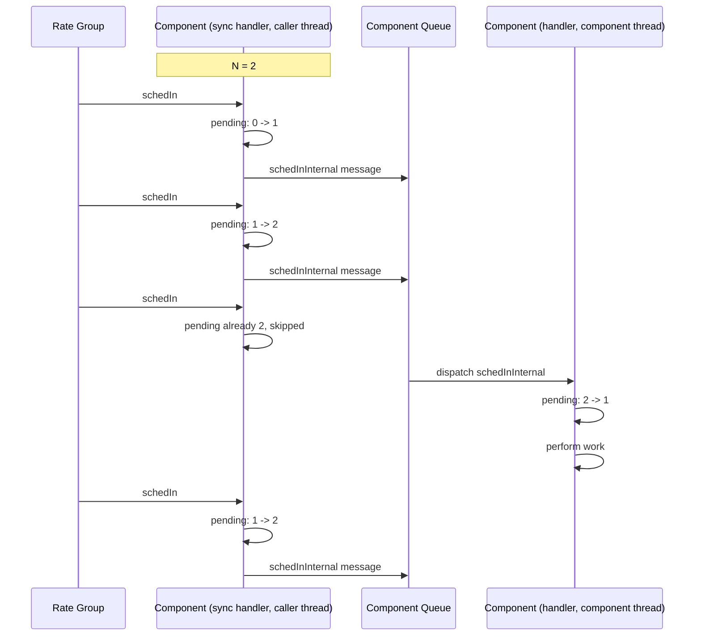

# Fixed Message Limit Pattern

The fixed message limit pattern bounds a repeating input to at most a fixed number, `N`, of messages on an active (or queued) component's queue. It generalizes the [single queued message pattern](./single-queued-message.md), which is the `N = 1` case. A synchronous input port handler runs on the caller's thread, atomically claims one of `N` admission slots, and invokes an internal port only when a slot was available. The internal port handler releases the slot and performs the work on the component's thread. The internal port uses the `hook` queue-full behavior so that an overflow also releases the slot. Inputs that arrive while all `N` slots are claimed are skipped.

The most common use case is a `Svc.Sched` input (`schedIn`/`run`) driving work that is allowed to fall a bounded number of cycles behind the rate group before cycles are skipped, such as paced processing of a backlog where each tick advances the work by one step. The fprime-examples repository provides an example of this pattern: [`FixedMessageLimit`](https://github.com/nasa/fprime-examples/tree/devel/FlightExamples/FixedMessageLimit).

## Applicability

Use this pattern when an active component receives a repeating input that should be processed once per occurrence while the component keeps up, but whose backlog must be capped when it does not. Occurrences beyond the cap are skipped rather than queued. Examples:

  - Rate group ticks (`Svc.Sched`) that each perform one increment of background work, where a small backlog of ticks is useful but an unbounded one is not.
  - Notifications carrying a payload (a reading, a status) where the most recent `N` are worth processing individually and older ones may be shed under load.
  - Any input that would otherwise be an `async input port` with `drop` behavior, but whose share of the component's queue must be limited independently of the other traffic on that queue.

An `async input port` bounds the input only by the whole queue: a flood of one input crowds out commands and other port messages until the queue fills, and only then does the configured queue-full behavior act. This pattern instead limits the input to `N` entries of the queue regardless of what else is queued, so a component that falls behind still has queue capacity for everything else.

Choose the [single queued message pattern](./single-queued-message.md) instead when running the work once covers every pending occurrence (telemetry writes, housekeeping); there is no value in queuing `N` identical messages. Do not use this pattern when every occurrence must be processed (buffers to be written, commands to be executed); such inputs need a queue sized for the worst case and an `assert` or `block` behavior that makes an overflow visible.

## Design

The pattern consists of three parts within one `active` (or `queued`) component:

1. A `sync` input port for the repeating input. Its handler runs on the caller's thread, and must do no more than claim a slot and invoke the internal port.
2. An `internal port` with `hook` queue-full behavior. Invoking it places one message on the component's queue; its handler runs on the component's thread and performs the work.
3. An atomic counter (`std::atomic<FwSizeType>`) of claimed slots, compared against a compile-time limit `N`. The counter is incremented in the sync handler and decremented in two places: the internal port handler (the message has been dequeued) and the internal port's overflow hook (the message was never queued).



The counter is decremented at the start of the internal handler, before the work is performed, so the count tracks messages that are on the queue (plus any claim whose invoke has not yet completed). An input arriving while the work runs can therefore claim the slot that the running message just released.

The invariant the pattern maintains is: **the number of this input's messages on the queue never exceeds `N`**. A message is only queued after a claim that observed fewer than `N` outstanding slots, so no sequence of concurrent callers can queue an `N + 1`th message.

The overflow hook exists for the same reason as in the single queued message pattern. `drop` would leak a slot on every overflow: after `N` overflows, the input would be skipped forever. `assert` and `block` punish the caller for a full queue it did not fill. `hook` releases the slot on the caller's thread so that the next input retries.

> [!IMPORTANT]
> The counter must be decremented in both the internal port handler and the overflow hook. Omitting the hook decrement (or using `drop`) permanently loses one slot per overflow.

## Implementation

The repeating input is declared as a `sync` input port, and a companion internal port is declared with `hook` queue-full behavior. The limit is an FPP constant so that the component's own documentation, its deployment, and its unit tests share one definition. The internal port is conventionally named `<port>Internal`, and the counter `m_<port>Pending`.

**Model Snippet**
```
module MyModule {
    @ Maximum number of schedIn messages held on the queue
    constant MAX_PENDING = 3

    active component MyComponent {
        ...

        @ Rate group input
        sync input port schedIn: Svc.Sched

        @ Internal port that performs one unit of schedIn work on the component thread
        internal port schedInInternal hook

        ...
    }
}
```

FPP generates three functions for the internal port: `schedInInternal_internalInterfaceInvoke()` (places the message on the queue), the pure virtual handler `schedInInternal_internalInterfaceHandler()`, and the pure virtual overflow hook `schedInInternal_overflowHook()`.

**Header Snippet**
```cpp
#include <atomic>

class MyComponent final : public MyComponentComponentBase {
    ...
  private:
    //! Handler for schedIn: claims a slot and queues one schedInInternal message
    void schedIn_handler(FwIndexType portNum, U32 context) override;

    //! Internal interface handler for schedInInternal: releases the slot and performs the work
    void schedInInternal_internalInterfaceHandler() override;

    //! Overflow hook for schedInInternal: releases the slot
    void schedInInternal_overflowHook() override;

    //! Number of schedInInternal messages claimed and not yet dequeued
    std::atomic<FwSizeType> m_schedInPending;
};
```

**Implementation Snippet**
```cpp
MyComponent::MyComponent(const char* const compName)
    : MyComponentComponentBase(compName), m_schedInPending(0) {}

void MyComponent::schedIn_handler(FwIndexType portNum, U32 context) {
    // Claim a slot first, then check whether the claim was within the limit
    const FwSizeType previous = this->m_schedInPending.fetch_add(1);
    if (previous < MyModule::MAX_PENDING) {
        this->schedInInternal_internalInterfaceInvoke();
    } else {
        // Over the limit: give the slot back and skip this occurrence
        this->m_schedInPending.fetch_sub(1);
    }
}

void MyComponent::schedInInternal_overflowHook() {
    this->m_schedInPending.fetch_sub(1);
}

void MyComponent::schedInInternal_internalInterfaceHandler() {
    FW_ASSERT(this->m_schedInPending > 0);
    this->m_schedInPending.fetch_sub(1);
    ... perform one unit of work on the component thread ...
}
```

The claim is a single `fetch_add`, which returns the value the counter held before the increment. A message is queued only when that value was below the limit. With concurrent callers the counter can briefly exceed `N` (each over-the-limit caller holds its increment until it gives it back), which causes a spurious skip for a caller racing with it but never admits an extra message: the invariant above is preserved. This bounded two-operation form is preferred for flight software over a compare-and-exchange retry loop, which admits exactly `N` under contention but has no fixed bound on its retries. Both operations are atomic, so no mutex and no `guarded` port is needed.

Setting `MAX_PENDING` to `1` yields the behavior of the single queued message pattern; that pattern's `std::atomic<bool>` and `compare_exchange_strong` form is the natural simplification when the limit is one.

## Testing and Verification

Standard F Prime [Unit Testing](../overview/unit-testing.md) applies. The sync handler only queues a message, so a test must dispatch the component (`doDispatch()`) after invoking the input before the work's effects (telemetry, events, output ports) appear in the tester history. `doDispatch()` blocks on an empty queue, so a test must dispatch exactly as many times as messages were queued.

The limit is verified by invoking the input more than `N` times before dispatching, then dispatching exactly `N` times and asserting that the work ran `N` times and that the excess occurrences were skipped (for example by a skip counter or event):

**Unit Test Snippet**
```cpp
for (FwSizeType i = 0; i < MyModule::MAX_PENDING + 2; i++) {
    this->invoke_to_schedIn(0, 0);
}
for (FwSizeType i = 0; i < MyModule::MAX_PENDING; i++) {
    this->component.doDispatch();
}
ASSERT_TLM_WorkCount_SIZE(MyModule::MAX_PENDING);
```

The release property is verified by invoking the input once more after that dispatch, dispatching again, and asserting that the work ran one more time. Overflow behavior is verified by filling the component's queue (for example with messages on another `async` input), invoking the sync input while the queue is full, draining the queue, and invoking the input `N` times: all `N` must queue, demonstrating that the overflow hook released the slot rather than leaking it.

## Other Considerations

### Inputs With Arguments

Unlike the single queued message pattern, this pattern can preserve the arguments of each admitted occurrence, because each occurrence that is admitted gets its own message. Declare the internal port with the arguments to be carried (`internal port schedInInternal(context: U32) hook`); FPP then generates the invoke, handler, and overflow hook with those arguments. No additional shared state is needed. Occurrences skipped at the limit lose their arguments, which is the intended load-shedding behavior.

### Choosing the Limit

`N` is the number of occurrences the component may fall behind before it begins skipping. It should be small: the point of the pattern is a known, fixed share of the queue. If the natural answer is "as many as the queue can hold", the input should be an `async input port` with `drop` behavior and the queue sized accordingly; if it is "one", use the single queued message pattern.

### Queue Sizing

The pattern guarantees that the input contributes at most `N` entries to the component's queue depth. Deployments should account for these `N` entries when sizing the queue, in place of the "one entry per tick in the backlog" allowance an `async` input requires.

### Passive Components

Internal ports require a queue, so this pattern applies only to `active` and `queued` components. A passive component performs its work directly in a `sync` or `guarded` handler on the caller's thread.

### Skipped Occurrences

An occurrence is skipped when `N` messages are already pending, and also when the component's queue is full. Components that must account for skips can count them in the sync handler and overflow hook with an atomic counter, and report the count from the internal handler on the component thread.

## Conclusion

The fixed message limit pattern bounds a repeating input to a fixed number `N` of pending messages on an active component's queue. A sync input port handler claims a slot with an atomic increment and queues one internal message per admitted occurrence; the internal handler releases the slot and does the work on the component thread; the internal port's overflow hook releases the slot on a full queue. The result is a known, fixed queue footprint of `N` entries, work that is processed once per occurrence while the component keeps up, and bounded load shedding when it does not. With `N = 1` it reduces to the [single queued message pattern](./single-queued-message.md).
