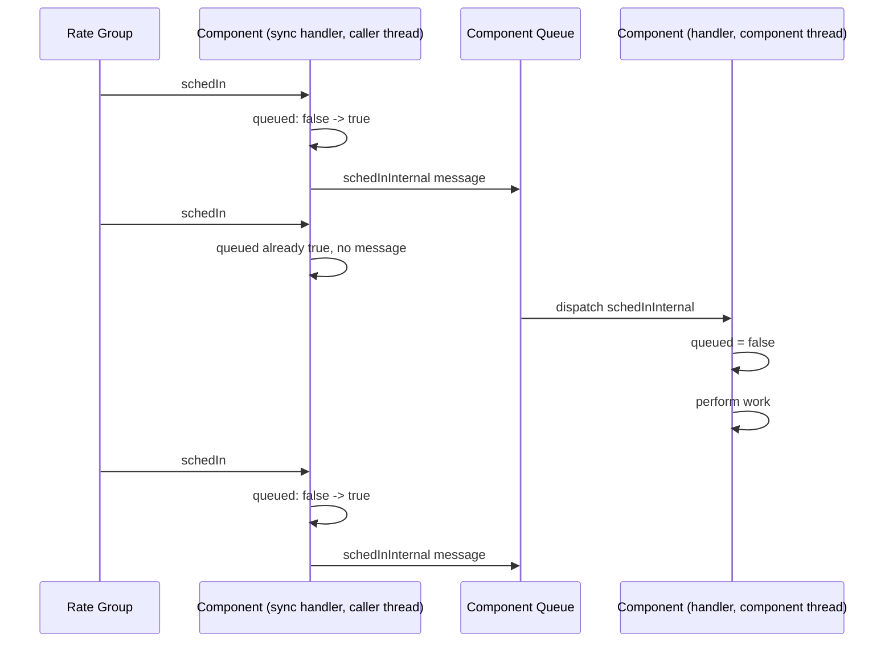

# Single Queued Message Pattern

The single queued message pattern bounds a repeating input to at most one message on an active component's queue. A synchronous input port handler runs on the caller's thread, atomically claims a "queued" flag, and invokes an internal port only when the flag was clear. The internal port handler clears the flag and performs the work on the component's thread. The internal port uses the `hook` queue-full behavior so that an overflow also clears the flag, allowing the next input to retry. Repeated inputs that arrive while a message is already queued are coalesced into that one message.

The most common use case is a `Svc.Sched` input (`schedIn`/`run`) that performs periodic work on an active component, such as writing telemetry. Reference implementations in the framework include [`Svc::EventManager`](../../../Svc/EventManager/EventManager.fpp), [`Svc::CmdDispatcher`](../../../Svc/CmdDispatcher/CmdDispatcher.fpp), [`Svc::ComQueue`](../../../Svc/ComQueue/ComQueue.fpp), [`Svc::DpManager`](../../../Svc/DpManager/DpManager.fpp), [`Svc::DpWriter`](../../../Svc/DpWriter/DpWriter.fpp), [`Svc::ComLoggerDp`](../../../Svc/ComLoggerDp/ComLoggerDp.fpp), [`Svc::FileManager`](../../../Svc/FileManager/FileManager.fpp), and [`Svc::WasmSequencer`](../../../Svc/WasmSequencer/WasmSequencer.fpp).

## Applicability

Use this pattern when an active component receives a repeating input whose individual occurrences carry no information that must be preserved. Only the fact that the input occurred matters, and running the work once covers every occurrence that arrived while it was waiting. Examples:

  - Rate group ticks (`Svc.Sched`) that trigger telemetry writes, housekeeping, or paced background processing.
  - Notifications that state has changed and a consumer should re-read it.
  - Periodic polling requests where the latest poll supersedes earlier ones.

Without this pattern, such an input is typically modeled as an `async input port`. Each occurrence then places a message on the component's queue regardless of how many are already waiting. A component that falls behind accumulates identical messages, which crowd out commands and other port messages. The configured queue-full behavior then forces a choice between asserting (`assert`), losing the input (`drop`), or stalling the caller (`block`), each of which is a system-level fault when the caller is a rate group.

Do not use this pattern when each input occurrence must be processed individually (for example, buffers to be written or commands to be executed), or when the input carries arguments that must not be lost. See [Other Considerations](#other-considerations) for inputs that carry a value.

## Design

The pattern consists of three parts within one `active` (or `queued`) component:

1. A `sync` input port for the repeating input. Its handler runs on the caller's thread, and must do no more than claim the flag and invoke the internal port.
2. An `internal port` with `hook` queue-full behavior. Invoking it places one message on the component's queue; its handler runs on the component's thread and performs the work.
3. An atomic flag (`std::atomic<bool>`) recording whether a message is currently queued. The flag is claimed with a compare-and-exchange in the sync handler, and cleared in two places: the internal port handler (the message has been dequeued) and the internal port's overflow hook (the message was never queued).



The flag is cleared at the start of the internal handler, before the work is performed. An input arriving while the work runs therefore queues a new message, so the work runs again afterwards. Because the message is already off the queue at that point, the queue never holds more than one message for this input.

The overflow hook exists because every other queue-full behavior defeats the pattern:

| Internal port behavior | Effect on a full queue |
| --- | --- |
| `assert` (default) | Asserts. The caller (e.g. the rate group thread) takes down the system because an unrelated flood filled the queue. |
| `drop` | Silently drops the message with the flag left set. No further input is ever queued: the component's periodic work stops permanently. |
| `block` | Blocks the caller until queue space frees. A rate group thread stalls, slipping every other component in the group. |
| `hook` | Calls `<port>_overflowHook()` on the caller's thread. The hook clears the flag so the next input retries. One occurrence is skipped; the next one succeeds once the queue drains. |

> [!IMPORTANT]
> The flag must be cleared in both the internal port handler and the overflow hook. Omitting the hook clear (or using `drop`) wedges the flag after a single overflow.

## Implementation

The repeating input is declared as a `sync` input port, and a companion internal port with no arguments is declared with `hook` queue-full behavior. The internal port is conventionally named `<port>Internal`, and the flag `m_<port>Queued`.

**Model Snippet**
```
active component MyComponent {
    ...

    @ Rate group input
    sync input port schedIn: Svc.Sched

    @ Internal port that performs the schedIn work on the component thread
    internal port schedInInternal hook

    ...
}
```

FPP generates three functions for the internal port: `schedInInternal_internalInterfaceInvoke()` (places the message on the queue), the pure virtual handler `schedInInternal_internalInterfaceHandler()`, and the pure virtual overflow hook `schedInInternal_overflowHook()`.

**Header Snippet**
```cpp
#include <atomic>

class MyComponent final : public MyComponentComponentBase {
    ...
  private:
    //! Handler for schedIn: claims the flag and queues one schedInInternal message
    void schedIn_handler(FwIndexType portNum, U32 context) override;

    //! Internal interface handler for schedInInternal: performs the work
    void schedInInternal_internalInterfaceHandler() override;

    //! Overflow hook for schedInInternal: re-arms the flag
    void schedInInternal_overflowHook() override;

    //! True while a schedInInternal message is on the queue
    std::atomic<bool> m_schedInQueued;
};
```

**Implementation Snippet**
```cpp
MyComponent::MyComponent(const char* const compName)
    : MyComponentComponentBase(compName), m_schedInQueued(false) {}

void MyComponent::schedIn_handler(FwIndexType portNum, U32 context) {
    bool expected = false;
    if (this->m_schedInQueued.compare_exchange_strong(expected, true)) {
        this->schedInInternal_internalInterfaceInvoke();
    }
}

void MyComponent::schedInInternal_overflowHook() {
    this->m_schedInQueued = false;
}

void MyComponent::schedInInternal_internalInterfaceHandler() {
    this->m_schedInQueued = false;
    ... perform the periodic work on the component thread ...
}
```

The `compare_exchange_strong` call succeeds, and sets the flag, only when the flag was `false`. Two callers racing on the sync port therefore produce exactly one message. The sync handler and the overflow hook run on the caller's thread; the internal handler runs on the component's thread. The atomic flag is the only state shared between them, so no mutex and no `guarded` port is needed.

> [!NOTE]
> The internal port handler may `FW_ASSERT(this->m_schedInQueued)` before clearing the flag; a message can only be dequeued after a successful claim. `Svc::FileManager` does this.

## Testing and Verification

Standard F Prime [Unit Testing](../overview/unit-testing.md) applies. The sync handler only queues a message, so a test must dispatch the component (`doDispatch()`) after invoking the input before the work's effects (telemetry, events, output ports) appear in the tester history:

**Unit Test Snippet**
```cpp
this->invoke_to_schedIn(0, 0);
this->component.doDispatch();
ASSERT_TLM_SIZE(1);
```

The coalescing property is verified by invoking the input several times before dispatching once and asserting that the work ran exactly once. The re-arm property is verified by invoking the input once more after that dispatch, dispatching again, and asserting that the work ran a second time. `doDispatch()` blocks on an empty queue, so a test must dispatch exactly as many times as messages were queued.

Overflow behavior is verified by filling the component's queue (for example with messages on another `async` input), invoking the sync input while the queue is full, draining the queue, and invoking the input again: the final invocation must queue a message that a single dispatch processes, demonstrating that the overflow hook cleared the flag. `Svc::EventManager`'s `runDroppedTelemetry` test follows this shape.

## Other Considerations

### Inputs With Arguments

The internal port in this pattern takes no arguments, because a coalesced message cannot carry the arguments of every occurrence it replaces. The `Svc.Sched` `context` argument is discarded for this reason. When the handler needs the most recent value of an input argument (e.g. a changed-state notification carrying the new state), store it in a separate atomic or mutex-protected member in the sync handler before claiming the flag, and read it in the internal handler. The internal handler then always observes the latest value, with intermediate values superseded.

### Queue Sizing

The pattern guarantees that the input contributes at most one entry to the component's queue depth. Deployments should account for this single entry when sizing the queue, in place of the "one entry per tick in the backlog" allowance an `async` input requires.

### Passive Components

Internal ports require a queue, so this pattern applies only to `active` and `queued` components. A passive component performs its periodic work directly in a `sync` or `guarded` `Svc.Sched` handler on the rate group's thread.

### Dropped Occurrences

When the queue overflows, one occurrence of the input is skipped; the work resumes with the next occurrence after the queue drains. Components whose periodic work must never be skipped should reserve queue depth so that overflow cannot occur, or count the skips in the overflow hook and report them via telemetry.

## Conclusion

The single queued message pattern coalesces a repeating input into a single pending message on an active component's queue. A sync input port handler claims an atomic flag and queues one internal message; the internal handler clears the flag and does the work on the component thread; the internal port's overflow hook clears the flag on a full queue so the input re-arms. The result is a bounded queue footprint of one entry, no asserts or stalls on the calling rate group, and periodic work that cannot wedge.
